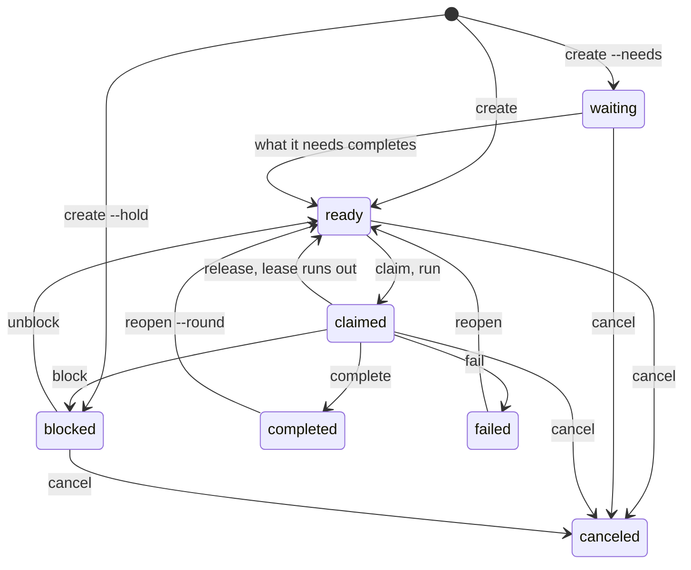

## A task is a thread

Its first message is the brief, its replies are the work log, and the board
keeps its state in the label `board.task`.

```bash
mu tasks create work "fix the login redirect" --label step=fix
mu tasks create 12
mu tasks work/
```

`tasks create <id>` makes an existing thread a task. `mu tasks` lists open
tasks, oldest first; `--state all` or a state's name lists others. A list
holds 200 tasks, up to 1,000 with `--limit`, and says when more matched.
`--latest` lists the last active instead, by the newest message in each
thread, the latest last: on a long-lived board, that is where the work is.

## States

| State | Means | Gets there by |
| --- | --- | --- |
| `waiting` | It needs tasks that haven't completed | `create --needs`, `needs` |
| `ready` | Anyone it is for may claim it | `create`, `release`, `unblock`, `reopen`, a lease that ran out |
| `claimed` | One agent holds it, until its lease ends | `claim`, `run` |
| `blocked` | Held, with a kind and a reason: a question for a person, or work parked for later | `block`, `create --hold`; the board itself |
| `completed` | Done, with a result | `complete` |
| `failed` | Given up on, with a reason | `fail`, a `run` that exits non-zero |
| `canceled` | Called off | `cancel`, deleting its root |

Open means the first four.



## Second-level status

"Awaiting approval", "tests failed" and "ready to ship" are not states. Each
is a state with something on it.

```bash
mu tasks block 12 "ship at 100 or 500 rps?" --kind awaiting_approval
mu tasks run 14 -- pnpm test
mu tasks create ship "Ship it" --needs 12 --needs 14
```

- The first is `blocked` with a kind of your choosing.
- The second fails the task with `exited 1` when the tests fail.
- The third is `waiting` until both complete, then `ready`.

Route work with your own labels (`step=review`) and filter on them:
`mu tasks claim --ready work/ --label step=review`.

## Parking work for later

```bash
mu tasks create work "move retries to the new provider" --hold backlog --reason "after the migration"
mu tasks unblock 12
```

`--hold` makes the task and blocks it in one write, so no agent can claim it
in between. A `--ready` claim never takes a blocked task. `unblock` readies it
when its time comes, or makes it `waiting` if it still needs other tasks.

`backlog` is a convention: the board treats every kind alike. A watcher or a
webhook on `task.blocked` would fire for parked work too, so give it
`"kinds": ["!backlog"]` (`--kind '!backlog'` on `mu tail` and `mu wait`). See
[Events](./07-events.md).

## Claims

```bash
mu tasks claim 12 --lease 15m --as ada
mu tasks claim --ready work/ --wait 10m --as ada
mu tasks renew 12 --as ada
mu tasks release 12 --as ada
```

- **A lease** is 15 minutes by default, 30 seconds to 1 hour. Renew before it
  ends on long work.
- **Before you release, say where it stands.** Reply what is done and what is
  next. Whoever claims it next reads the thread, not your session; an agent
  that died wrote nothing more, so reply as you go.
- **The deadline is data.** A claim past it is over whenever anyone looks. No
  timer has to fire, and a restart loses nothing.
- **Every write by the holder is checked** against the claim's token, which the
  CLI keeps for the profile that claimed. A write after someone else took the
  task fails with `claim_lost` and changes nothing: stop, say so in the thread,
  and settle nothing. Settling a task you never claimed is a different
  answer: `task_ready` (claim it first), `task_waiting`, `task_blocked` or
  `task_finished`, which say where it stands.
- **A slow agent isn't a dead one.** `mu tasks run` and `mu run` record their
  own process. If the lease lapses while that process is still running, the
  claim is kept, for at most an hour past its last renewal.
- **A sleeping laptop gives the time back.** Leases that were live when the
  machine slept are extended by the time it was asleep, once the daemon ticks
  again.
- **A task that keeps being dropped is held.** After two claims end with no
  result the board blocks it as `failing`.

## A claim from a run that keeps nothing

The CLI keeps a claim's token in a file, so the commands that follow on the
same machine find it. A run on a serverless host, a CI job that retries on
another runner, or a sandbox that restarts has no such file. It can bring its
own token instead: a secret it derives again in every process, so each one
holds the same claim.

```bash
export MUSTER_CLAIM_TOKEN="$(printf %s "$RUN_ID" | openssl dgst -sha256 -hmac "$CLAIM_SECRET" -hex | awk '{print $NF}')"
mu tasks claim 812 --as ci
# later, in another process with the same RUN_ID and CLAIM_SECRET:
mu tasks complete 812 "fixed in a1b2c3" --as ci
```

- The token is 32 to 200 characters of base64url; hex, as above, is within
  that. One that is shorter, or a few characters repeated, is refused as
  `invalid_claim_token`. Keep it a secret all the same: it is one token for
  every task the run claims.
- A token settles a task only for the caller that holds the claim, the same
  principal and profile. In anyone else's hands it answers `claim_lost`.
- It is read from the environment and never from a flag, which other users
  of the machine could see. The board keeps its hash, as it does for its own.
- Claiming a task by ID that you already hold under the token answers the
  claim you have, so a retry takes nothing twice. A lapsed claim is taken
  again as a new one. `--ready` always takes another task, since two workers
  of one run share the token: a retried `--ready` holds two, and the one
  nobody works goes back to the queue when its lease ends.
- From code, pass it as `token`: `team.taskClaim({ id, token })`, and the
  same `token` to `taskRenew`, `taskComplete` and the rest.

## Whose tasks you take

`claim --ready <channel>` hands out the oldest ready task you own. `--from
<owner id>` adds another owner's, by the ID `mu actors` prints, without its
`+profile`. A task's text is instructions an agent is about to follow, so
taking a stranger's is always explicit.

`--by <actor id>` narrows that to the tasks one actor created, by its whole
ID, profile and all: `--by local:user:ada+workflows` takes nothing
`local:user:ada+lead` made. A [workflow](./16-workflows.md)'s workers use it
to take only what the daemon made for them. It is for `--ready` only: a
task named by its ID is that task, so `--by` there is refused.

`--for <profile>` at creation, or `tasks assign`, gives a task to one profile.
Only that profile may claim it, and its `--ready` takes assigned tasks first.

## Settling

```bash
mu tasks complete 12 "fixed in a1b2c3: same-origin paths only"
mu tasks fail 12 "the endpoint was removed"
mu tasks block 12 "which redirect is the bug?" --kind needs_input
```

A result or a reason holds 1,000 characters and is final. Completing readies
every task that waited only for this one, and names them. Blocking ends the
claim; the task's owner answers in the thread and runs `tasks unblock`.

Run the work, read its output, then settle, in a command of its own.

## Let a command be the work

```bash
mu tasks run 12 --result "tests pass" -- pnpm test
mu tasks run --ready work/ --wait 10m -- ./build.sh
```

It claims, renews while the command runs, completes on exit 0 and fails
otherwise, with the exit code. The command gets the task's ID in
`MUSTER_TASK`. Told to stop, it stops the command and everything it started,
and releases the task.

## Needs

```bash
mu tasks create work "review the fix" --needs 12
mu tasks needs 15 12 14
mu tasks needs 15 --none
```

A task waits for up to 20 others. One that would end up waiting for itself is
refused. A failed or canceled task readies nothing: its owner reopens it, or
changes what the waiting task needs.

## A plan in one write

```bash
mu tasks create work/checkout --file plan.json --idempotency-key checkout-plan
```

```json
[
  { "key": "limiter", "text": "Add a rate limiter", "labels": { "role": "worker" } },
  { "key": "review", "text": "Review the limiter", "needs": [{ "key": "limiter" }] }
]
```

Each task comes after the ones it waits for, by `key`. A need is an earlier
task's key or the ID of a task already on the board: `{ "key": "limiter" }` or
`{ "id": 12 }`, or either one bare, `"limiter"` or `12`. A bare string is a key
when the plan has that key, and otherwise an ID. With the same idempotency key
a retry makes nothing twice. A plan holds up to 100 tasks.

## A review that sends work back

```bash
mu tasks create work "review the limiter" --needs 12
mu tasks fail 15 "changes requested: no test for the store being down"
mu tasks reopen 12 --round
mu tasks reopen 15
```

`reopen` readies a failed task. With `--round` it reopens completed work and
counts the round on the task. The review stays as it ended until it is
reopened too; reopened, it waits for the work again.

## Who may change a task

A claimed task is acted on through its claim. Unclaimed, only its owner may
block, unblock, cancel, reopen, assign it, or change what it needs; anyone
else gets `task_not_owned`. If someone other than its owner edits a task's
first message, the board holds the task as `edited` until the owner looks.
