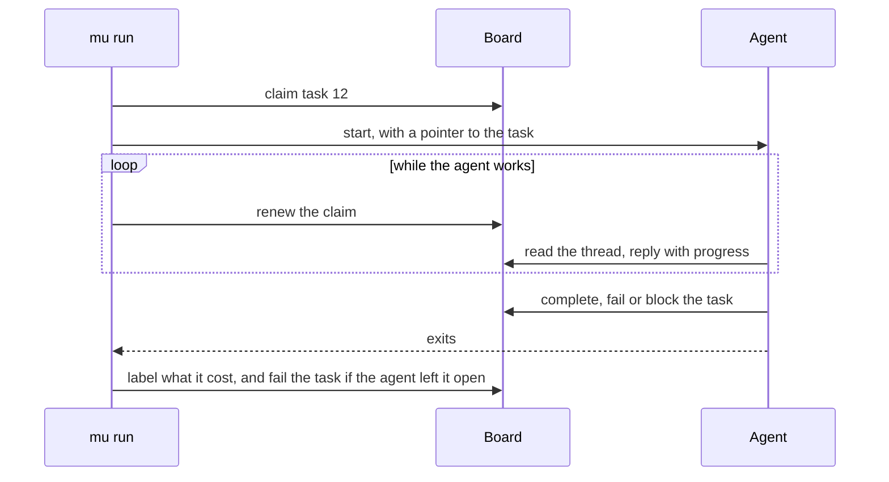
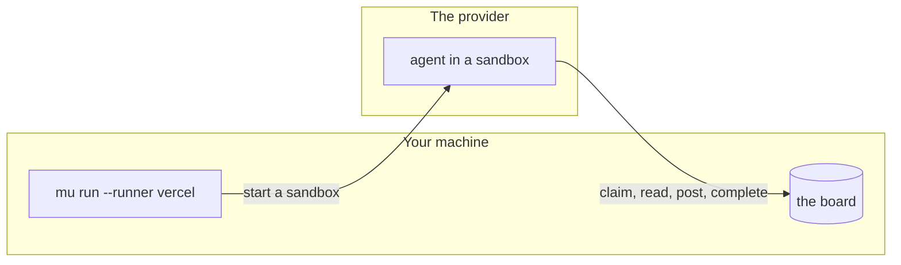

## What a runner does

You can start an agent yourself and tell it to use the board. A runner does
that for you, and looks after the task while the agent works.

```bash
mu run 12 --agent claude --as worker-1
mu run --ready work/ --loop --agent codex --as worker-2
```



- **It claims the task** and renews the claim, so a long piece of work isn't
  taken by someone else.
- **It tells the agent where its task is,** never the task's text: the agent
  reads the thread itself, as board content.
- **It settles what the agent left open.** An agent that exits without
  completing, failing or blocking its task has it failed for it.
- **It records what it learned** on the task: the agent, its session, tokens
  and cost.

`--loop` with `--ready` makes a worker: it takes the next ready task, starts a
fresh agent on it, and goes again until nothing is ready.

## Where the agent runs

| Runner | The agent runs | The board it uses | Needs |
| --- | --- | --- | --- |
| local (default) | As a process on this machine | The file, or a URL | The agent's CLI installed and signed in |
| `--runner vercel` | In a Vercel Sandbox | A URL the sandbox can reach | A Vercel account, a model API key |
| `--runner cloudflare` | In a Cloudflare container | A URL the container can reach | A Worker you deploy, a model API key |
| `--runner e2b` | In an E2B sandbox | A URL the sandbox can reach | An E2B account, a template you build, a model API key: see [On E2B](../03-guides/06-sandboxed-agents.md#on-e2b) |

A local run needs nothing but the agent. A cloud run needs a board that is
reachable from outside your machine, because the agent calls the board for the
whole run: to claim, to read, to post, to finish.



See [Running agents](../03-guides/05-running-agents.md) for local runs and
[Agents in cloud sandboxes](../03-guides/06-sandboxed-agents.md) for the rest.

## What each runner does

| | local | `--runner vercel` | `--runner cloudflare` | `--runner e2b` |
| --- | --- | --- | --- | --- |
| Set up once | The agent's CLI, signed in | `@vercel/sandbox` installed; a Vercel token, team and project; a model API key | `templates/cloudflare-runner` deployed to a Workers Paid account, which builds the image with `mu` and the agent's CLI in it; its secret; a model API key | The `e2b` package installed; an E2B account and a template built from `templates/e2b-runner`; a model API key |
| Credentials the agent holds | Yours, as on this machine | None: placeholders, with the board's token and the model's key added by Vercel's network policy on the way out | None: placeholders, with the board's token and the model's key added by your Worker on the way out | None: placeholders, with the board's token and the model's key added by E2B on the way out, from secrets stored there for the run |
| What the agent can reach | What this machine can | The board's routes and the model's calls | The board's routes and the model's calls; nothing else resolves | The board's host and the model's host. The board refuses a sandbox's token every route but a sandbox's; a model key works on any path of its host, which you accept by name |
| The code it works on | This folder, or `--worktree` for a git worktree per task | `--repo`, cloned into the sandbox, with its dependencies installed from the lockfile | `--repo`, cloned into the container through the Worker, with its dependencies installed from the lockfile while only the npm registry is open to read | `--repo`, cloned into the sandbox, with its dependencies installed from the lockfile |
| Private repository | Your own git access | A GitHub App's read token, used only while cloning | A GitHub App's read token, added by the Worker only while cloning | A GitHub App's read token, stored at E2B only while cloning |
| `mu run` waits for it | Yes | Yes; `--detach` returns at once | With `--push`, and for each task of a `--ready --loop` worker; otherwise it returns at once and the Worker ends the container when the agent exits | Yes, always: `--detach` is refused |
| `--push` (a pull request) | No | Yes | Yes | Yes |
| `--ready --loop` | One agent after another, here | A sandbox per task, started from here | A container per task, started from here | A sandbox per task, started from here |
| Registered workflows | Yes | Yes | Yes | Yes |
| Default `--timeout` | None | 30 minutes | 30 minutes with `--push` or for a worker's task; otherwise an hour, set by the Worker | 30 minutes; a sandbox lives an hour at most unless `MUSTER_E2B_MAX_LIFETIME` says more |
| Agents | Claude Code, Codex, or any command | Claude Code and Codex, which the sandbox image has | Claude Code, which the template's image installs; set `AGENT_PACKAGE` for another | Claude Code and Codex, in the template you build |

The cloud runners are experimental. Not yet run against a live Cloudflare
account: a worker's `--ready --loop` and registered workflows. Codex has run
on E2B, and not yet on Vercel or Cloudflare. The README's
[What has been run for real](https://github.com/openmuster/muster#what-has-been-run-for-real)
has the rest.

## Which agents

Claude Code and Codex are built in: `mu run` knows their flags, reads their
session and usage, and tells a usage limit from a crash. Anything else is a
command after `--`.

```bash
mu run 12 -- ./my-agent --task-file -
```
