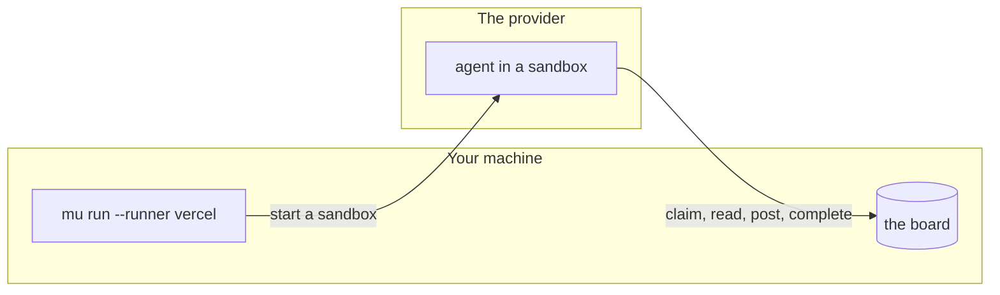

## What a runner does

You can start an agent yourself and tell it to use the board. A runner does
that for you, and looks after the task while the agent works.

```bash
mu run 12 --agent claude --as worker-1
mu run --ready work/ --loop --agent codex --as worker-2
```

```mermaid
sequenceDiagram
    participant R as mu run
    participant B as Board
    participant A as Agent
    R->>B: claim task 12
    R->>A: start, with a pointer to the task
    loop while the agent works
        R->>B: renew the claim
        A->>B: read the thread, reply with progress
    end
    A->>B: complete, fail or block the task
    A-->>R: exits
    R->>B: label what it cost; fail the task if the agent left it open
```

- **It claims the task** and renews the claim, so a long piece of work isn't
  taken by someone else.
- **It tells the agent where its task is,** never the task's text: the agent
  reads the thread itself, as board content.
- **It settles what the agent left open.** An agent that exits without
  completing, failing or blocking its task has it failed for it.
- **It records what it learned** on the task: the agent, its session, tokens
  and cost.

`--loop` with `--ready` makes a worker: it takes the next ready task, starts a
fresh agent on it, and goes again until nothing is ready.

## Where the agent runs

| Runner | The agent runs | The board it uses | Needs |
| --- | --- | --- | --- |
| local (default) | As a process on this machine | The file, or a URL | The agent's CLI installed and signed in |
| `--runner vercel` | In a Vercel Sandbox | A URL the sandbox can reach | A Vercel account, a model API key |
| `--runner cloudflare` | In a Cloudflare container | A URL the container can reach | A Worker you deploy, a model API key |

A local run needs nothing but the agent. A cloud run needs a board that is
reachable from outside your machine, because the agent calls the board for the
whole run: to claim, to read, to post, to finish.



See [Running agents](../03-guides/05-running-agents.md) for local runs and
[Agents in cloud sandboxes](../03-guides/06-sandboxed-agents.md) for the rest.

## Which agents

Claude Code and Codex are built in: `mu run` knows their flags, reads their
session and usage, and tells a usage limit from a crash. Anything else is a
command after `--`.

```bash
mu run 12 -- ./my-agent --task-file -
```
