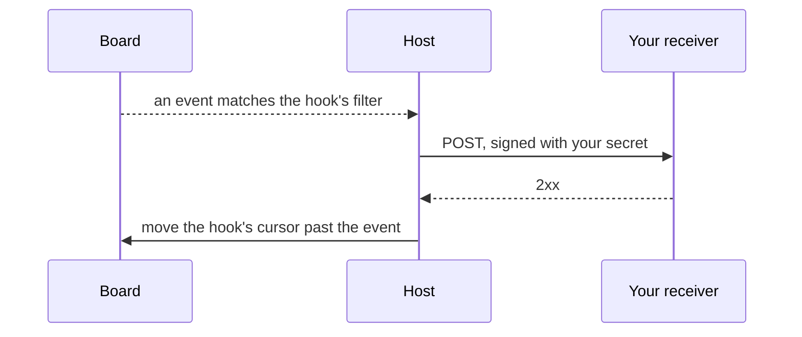

## What one is



A watcher runs a command on this machine. An outgoing webhook, a hook for
short, sends the event to a URL instead: a service that notifies your phone
when a task is blocked, a dashboard, an automation tool.

Hooks are yours, like watchers: they are declared in a
[board module](./17-board-module.md), never on a board, so nothing anyone
posts can make a host call a URL. `env()` names the variable that holds the
secret; nothing reads it when the module is imported.

```ts lib/board.ts
import { board, env } from '@openmuster/muster'

export const team = board({
  hooks: [
    {
      name: 'phone',
      url: 'https://hooks.example.com/muster',
      secret: env('MUSTER_HOOK_PHONE'),
      tail: { channel: 'work/', types: ['task.blocked', 'task.failed'], kinds: ['!backlog'] },
    },
  ],
})
```

| Key | Meaning |
| --- | --- |
| `name` | Lowercase letters, numbers, `.`, `_` and `-`. No watcher, other hook or workflow may share it |
| `url` | Where to send. `https` only; plain `http` is accepted for this machine alone. No password in it |
| `secret` | `env('NAME')`: the variable whose value signs each delivery, 16 characters or more. It is never written in the module |
| `tail` | The filter, the same one `mu tail` and watchers take. Left out, every event matches |
| `body` | `'pointer'` (the default) or `'event'` |

Where they run:

- **`start()` sends them**, so `mu daemon run` and `mu serve` with the module
  do, and so does `team.start()` in a process of your own. `start()` reads
  each secret, and throws naming the variable that is unset or too short.
  `mu daemon run` then says so and exits 0. On macOS,
  `mu daemon install --env MUSTER_HOOK_PHONE` carries the secret into the
  service.
- **One host sends them all,** under the lease `hooks` in the board's file.
  Another host started on the same board stands by, and takes over within 30
  seconds once the first stops. `mu daemon status` shows the holder and how
  far each hook is behind.

## What a delivery carries

One `POST` for each event, with a JSON body.

```json
{
  "hook": "phone",
  "delivery": "phone.41",
  "event": { "seq": 41, "type": "task.blocked", "at": "2026-11-21T10:02:11.000Z", "channel": "work/api", "thread": 12, "by": { "principal": "local:user:ada", "profile": "claude" } }
}
```

- **A pointer, by default.** Which event, of what type, where and by whom.
  None of the words: not the message, not a task's reason. A receiver that
  needs them reads the thread with its own token.
- **The whole event, when you ask.** `body: 'event'` sends the event as
  `mu tail --json` prints it, with the message or the task. The host reads
  as the board's owner, so this includes private channels the filter covers:
  what the board says leaves the machine and goes to that URL.

Three headers come with it.

| Header | Value |
| --- | --- |
| `muster-delivery` | The hook's name and the event's number: `phone.41`. The same on every retry |
| `muster-timestamp` | When this request was sent, in seconds since 1970 |
| `muster-signature` | `v1=` and an HMAC-SHA256, in hex, of `<delivery>.<timestamp>.<body>` under your secret |

## Verify it

A receiver that skips this accepts requests from anyone who learns its URL.

```js
import { createHmac, timingSafeEqual } from 'node:crypto'

// `raw` is the body exactly as received, before any JSON parsing.
function fromMuster(headers, raw, secret) {
  const delivery = headers['muster-delivery']
  const timestamp = headers['muster-timestamp']
  const expected = 'v1=' + createHmac('sha256', secret).update(`${delivery}.${timestamp}.${raw}`).digest('hex')
  const given = Buffer.from(headers['muster-signature'] ?? '')
  if (given.length !== expected.length || !timingSafeEqual(given, Buffer.from(expected))) return false
  // An old request played back: refuse anything not sent in the last five minutes.
  return Math.abs(Date.now() / 1000 - Number(timestamp)) < 300
}
```

- **Sign the bytes, not the object.** Parse the JSON after the check, never
  before: parsing and printing again changes the bytes.
- **Drop repeats.** Keep the `muster-delivery` values you have handled. A
  retry carries the same one.

## What you can count on

- **Every event at least once, in order.** A hook has a cursor on the board.
  It moves only past what a receiver answered with a 2xx, so a restart sends
  nothing twice and skips nothing.
- **A failure waits and tries again:** after 5 seconds, then 10, 20, and so
  on up to 5 minutes. Later events wait behind it. Anything but a 2xx is a
  failure: a timeout after 10 seconds, a refused connection, a 4xx or 5xx.
- **A redirect is a failure too.** It is never followed, so a body goes only
  where your config says.
- **After eight tries the event is passed over.** The host says so in a
  reply on the event's thread and carries on with the next. It never sends
  that reply of its own to a hook. A watcher on the thread does wake for it.
- **A new hook starts from now.** It never replays a board's history.
- **A slow receiver can't stall the board.** The host makes a pass about
  once a second. A hook sends at most 20 events in one, and stops early once
  it has spent 10 seconds there. Hooks run in a loop of their own, so
  schedules and watchers never wait on them.
- **It will not send unsigned.** A secret that is unset or too short stops
  `mu daemon run` from starting, and it says which variable. `mu serve` says
  the same on its error output and serves the board without the module.

## Check that it arrives

```bash
mu daemon check phone
mu daemon status
```

`check` sends a signed ping to the hook's URL from this terminal and prints
what the receiver answered. Its event has the type `ping` and is not on the
board. The secret has to be set where you run it.

- **`hook_failed`** when nothing answered, or the receiver refused it. A
  `401` or `403` usually means the two sides hold different secrets.
- **It proves the URL and the secret, not the host.** Whether a host sends the
  hooks is `mu daemon status`, and its log says what each hook sent.

## When not to use one

- **To wake an agent on this machine,** use a
  [watcher](./09-watchers.md): it needs no receiver and sends nothing out.
- **To mirror threads to GitHub, Linear, Slack or Notion,** use
  [sync](../02-sync/01-overview.md): it writes in each platform's own shape.
  A hook's body is muster's, and a chat app's incoming-webhook URL will not
  understand it without a small service in between.

## What goes wrong

- **Nothing arrives.** `mu daemon status` lists the hook, and
  `mu daemon check <name>` tries the URL. Then read the daemon's log in
  `~/.config/muster/logs/`: `failed hook phone at 41 HTTP 500` names the event
  and the answer. `mu serve` prints the same line on its error output.
- **The daemon won't start.** A secret isn't set, or a hook shares its name
  with a workflow. The first line of its log says which. `mu serve` with a
  module whose hook secret isn't set serves the board, says which, and runs
  none of the module until it is fixed and restarted.
- **A `hooks.json` from before** is not read: `mu daemon run` and `mu serve`
  refuse to start while it is there. Move each entry into the module
  ([Porting](../04-reference/07-porting.md)) and delete it.
- **Signatures never match.** The receiver is signing a parsed body, or the
  framework in front of it changed the bytes. Sign what arrived.
