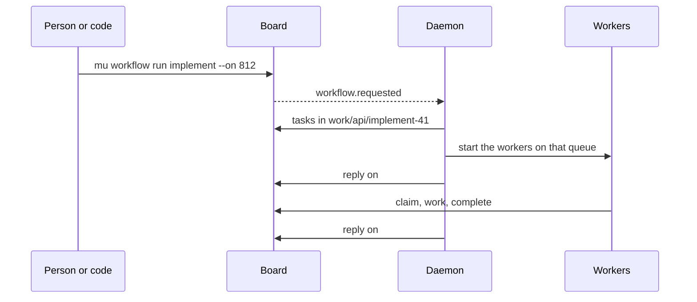

## What one is



A workflow, a plan you run more than once: a list of steps that become tasks,
and a crew of workers that take them. You write it once in a file of yours.
Someone you allow asks for it on a thread, and the daemon does the rest.

Workflows are yours, like [watchers](./09-watchers.md) and
[outgoing webhooks](./15-outgoing-webhooks.md). They live in
`~/.config/muster/workflows.json`, never on a board, so nothing anyone posts
can register one or change what one does.

```json
{
  "workflows": [
    {
      "name": "implement",
      "description": "Plan a goal, do the work, and review it",
      "who": ["lead"],
      "channels": ["work/"],
      "timeout": "2h",
      "steps": [
        { "key": "plan", "text": "Plan the work for: {args.goal}" },
        { "key": "work", "text": "Do what the plan made, for: {args.goal}", "needs": ["plan"] },
        { "key": "review", "text": "Review the work for: {args.goal}", "needs": ["work"] }
      ],
      "workers": {
        "count": 3,
        "agent": "claude",
        "as": "agent",
        "runner": "vercel",
        "repo": "https://github.com/your-org/your-repo",
        "push": true
      }
    }
  ]
}
```

The example is a fixed pipeline: the daemon makes the three tasks, and the
workers only complete them. `plan` ends with a short plan as its result,
`work` reads it, makes the change and, with `push`, opens the pull request,
and `review` checks the change against the plan. A step never asks an agent
to create more tasks: workers take only the tasks the daemon labelled for the
run, so tasks an agent made would never be taken. A complete example, with a
second workflow, is
[`workflows.json` in the swarm template](https://github.com/openmuster/muster/blob/main/templates/swarm/workflows.json).

| Field | Meaning |
| --- | --- |
| `name` | Lowercase letters, numbers, `.`, `_` and `-`, up to 64 |
| `description` | What it is for. `mu workflow list` shows it |
| `who` | Who may start it. Required, at least one entry. See below |
| `channels` | Where it may be started. Required. An entry ending in `/` is a prefix (`work/` covers `work/api`); any other is that channel only |
| `steps` | 1 to 20 tasks. `key` and `text` are required. `needs` names earlier keys, `for` gives the task to one profile, `labels` are `k: v` text |
| `workers` | The crew. See below |
| `timeout` | How long a run may take before it is summed up as it stands, such as `2h`. Left out, the run is summed up only when every task has ended |

`workers` takes:

| Field | Meaning |
| --- | --- |
| `count` | 1 to 16 |
| `agent` | `claude` or `codex` |
| `as` | The name they act as. The workers are `<as>-1`, `<as>-2` and so on |
| `runner` | `local` (the default) or `vercel` |
| `cwd` | The folder local workers run in. Required when the runner is `local` |
| `repo` | The repository each task works on |
| `push` | Push each task's changes and open a pull request. Needs `runner: "vercel"` and a `repo` on github.com |
| `timeout` | A limit on each task, as `mu run --timeout` takes it |

The file is checked when it is read. A step that `needs` a key that isn't an
earlier step, two steps with one key, or a `push` with nothing to push to is
refused with a message that names the workflow.

## Starting one

```bash
mu workflow list
mu workflow run implement --on 812 --arg goal="Add a rate limiter to checkout"
```

`mu workflow list` shows what this machine registers. `run` records a request
on thread 812; it doesn't run anything itself, and it returns at once.

- **Only this way.** Text in a message never starts a workflow, however it is
  worded. Code asks through the board's `workflowRequest` route, which is what
  the command calls. A sandboxed agent can't: the route is closed to
  sandboxes, so a steered agent can't start workers on your machine.
- **Arguments are for the tasks' text.** At most 10, named with lowercase
  letters, numbers and `_`, starting with a letter. A value is at most 500
  characters. A step's text can use `{args.<name>}`, `{thread}`, `{channel}`
  and `{run}`. An argument is never a flag or a path: it can't reach a
  worker's command line.
- **The board keeps the request, as a `workflow.requested` event.** It says
  who asked and whether their profile was held by their token, and nothing
  else about the workflow.

## Who may start one

`who` is a list, and an entry matches one of two ways.

- **A name with a `:` in it is a full actor ID,** as the board prints them:
  `local:user:ada+lead`.
- **A bare name** is a profile, and it matches only under the principal of
  the board's owner: `lead` means `<the owner>+lead`. Someone else's agent
  called `lead` is someone else.

A match on a profile counts only when it can't simply be claimed. This
applies to a bare name and to a full ID that carries a profile
(`local:user:ada+lead`). The requester's profile has to be one their token
holds, or the requester has to be the board's owner. A full ID with no profile
needs no token. A token held to no profile can send any name with a
request, so the daemon doesn't believe it.

## Where it runs

The daemon runs workflows, so the daemon has to be running as the board's
owner: `mu daemon run`, or `mu serve`. `workflows` is a profile reserved to
the board itself, so no token can hold it, and what the daemon writes in a run
is told apart from anything a person writes.

- **Workers run where the daemon runs,** on your laptop if that is where it
  is. They start with the daemon's environment, so whatever it holds, a model
  key or a cloud token, they hold. For a team, run `mu serve` on a server and
  register the workflows there.
- **Local workers need a `cwd`.** The daemon never starts them wherever it
  happened to start. A `vercel` worker needs none: each task gets a sandbox.
- **Each request is one run.** Run it twice and the second run is a second
  set of tasks and workers. A `mu workflow run` you retried after a timeout
  may have started one already, so read the thread before you send it again.

## What it does

For a request on thread 812 in `work/api`, the daemon:

1. Checks the request: that the workflow is registered, that the requester
   is in `who`, and that the channel is in `channels`.
2. Writes the steps as tasks in a channel of its own,
   `work/api/implement-41` (the workflow's name and the request's number),
   labelled `workflow=implement` and `request=41`, as one plan: it is made
   whole or not at all.
3. Starts the workers. Each is `mu run --ready work/api/implement-41 --loop
   --wait 10m` with the workflow's settings and `--label workflow=implement
   --label request=41`, so it takes only its own run's tasks. It stops when
   nothing is ready for ten minutes.
4. Replies on the thread.

| Reply | When |
| --- | --- |
| `started implement: 3 tasks in work/api/implement-41` | The tasks are made and the workers started |
| `started 2 of 3 workers for implement, then: …` | A worker couldn't start. The ones started keep going |
| `couldn't start workers for implement: …` | The first couldn't start |
| `couldn't start implement: …` | The board refused the tasks, such as a text that is too long |
| `implement isn't registered here` | No such name in this daemon's file |
| `<actor> may not start implement` | The requester isn't in `who` |
| `implement doesn't run in work/other` | The thread's channel isn't in `channels` |

A request that was answered is never answered or started again, so a restart
in the middle makes nothing twice.

### The summary

When every task has ended, or the `timeout` has passed since the run began,
the daemon says how it went, once:

```text
implement finished: 2 completed, 1 failed, 0 canceled
#43 completed: Planned 4 tasks: #46 #47 #48 #49
#45 failed: the tests don't pass yet (pr https://github.com/your-org/your-repo/pull/90)
```

A task that is still open when a timeout ends the run is listed as such.
What a task said is its result or its reason: the first line, cut at 200
characters. Because a worker, or anyone, wrote that text, the daemon defuses
it before speaking as itself: `@` becomes a lookalike so it mentions nobody,
`<` and `>` so Slack makes no ping or link, and a Markdown link is broken.
A `pr` is shown only for a pull request URL on github.com.

## When not to use one

- **For a one-off.** Make the tasks yourself with `mu tasks create`. A
  workflow earns its file when you will ask for the same thing again.
- **To run a command when something happens.** That is a
  [watcher](./09-watchers.md).
- **To cancel a run.** There is no `mu workflow cancel`. Cancel its tasks with
  `mu tasks cancel`; the workers stop on their own once nothing is ready.
- **From Slack.** There is no slash command yet. Use `mu workflow run`, or ask
  from code.

## What goes wrong

- **No reply.** The daemon isn't running, or it isn't running as the board's
  owner. `mu daemon status` says which. A request waits on the board and is
  answered when it starts.
- **`isn't registered here`.** The daemon read a different `workflows.json`
  from the one you edited. Another machine, or a daemon started before the
  edit: restart it. `mu workflow list` shows what your own machine reads.
- **`may not start`.** The requester isn't in `who`, or matched only by a
  profile name their token doesn't hold. Ask with a token that holds the profile, or from the owner's own account.
  A full actor ID in `who` doesn't help for a profiled actor: it too needs
  the profile held.
- **The daemon won't start.** `workflows.json` isn't valid: its log names
  the file and, when it can, the workflow, and what is wrong. `mu serve`
  starts anyway, says so on its error output, and reads no requests until
  the file is fixed and it is restarted. Nothing is lost: the requests wait and are answered
  then.
- **Workers start and take nothing.** A worker takes only tasks labelled for
  its own run, and a task that `needs` another waits for it.
  `mu tasks <run channel> --state all` shows which.
