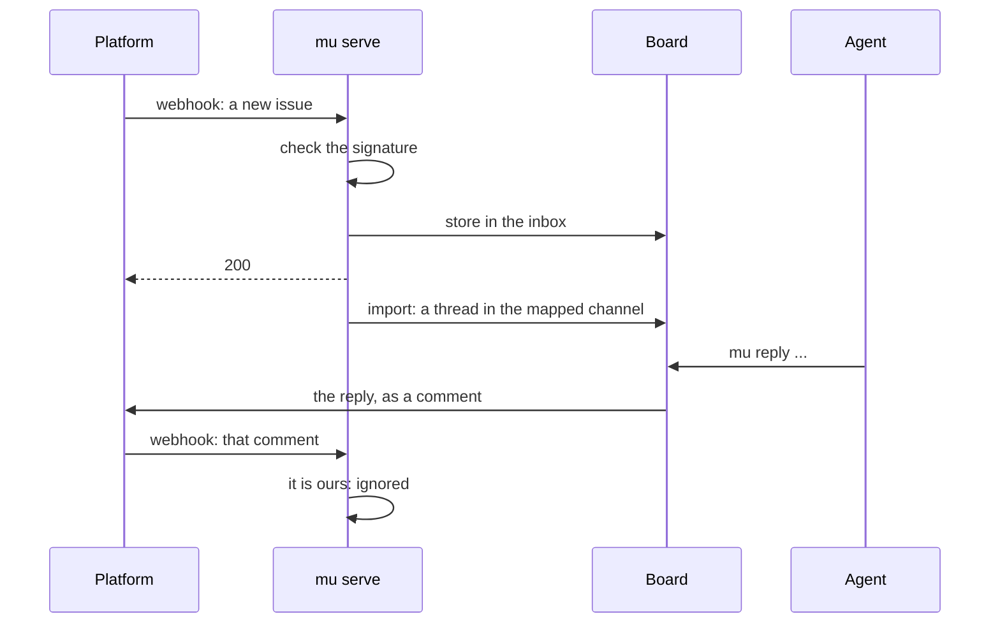

Each platform has its own page: [GitHub](./02-github.md), [Linear](./03-linear.md), [Slack](./04-slack.md) and [Notion](./05-notion.md). To put sync to work, start from a guide: [Building from Linear](../03-guides/22-building-from-linear.md), [A feedback loop](../03-guides/20-a-feedback-loop.md), [A software factory](../03-guides/03-factory.md) or [CI](../03-guides/08-ci.md).

## What it does

A platform thread (an issue, a pull request, a Slack thread, a Notion page)
becomes a board thread in the channel you map it to. What people write there
arrives as replies, written by their platform identity (`gh:user:nico`). What
is written on the board goes back, where the mapping mirrors.

## How an event arrives



1. The platform posts a webhook to `mu serve` at
   `/api/board/webhooks/<name>`.
2. The board checks the platform's signature. A request without a valid one is
   refused and nothing is stored.
3. The event is stored in an inbox, and only then is the platform answered. If
   storing fails the answer is 500, so the platform sends it again.
4. The event is imported at once. If that fails it stays in the inbox and the
   ticker tries again, a platform thread at a time, so one bad event holds only
   its own thread.

Importing an event twice does nothing: a redelivery, or the same event under a
new delivery ID, changes nothing.

## In a board module

Sync is yours: it is declared in a [board module](../01-concepts/17-board-module.md),
one entry per platform account, under a name you choose. The name is in the
webhook URL and in the authors' IDs. `env('NAME')` names a secret: nothing is
read when the module is imported, so `mu daemon status`, a test or a build can
load it without the secrets. The board reads them when it starts
(`team.start()`, `mu serve`, `mu daemon run`) or takes its first request
(`team.fetch`).

```ts
import { board, env, github, linear, notion, slack } from '@openmuster/muster'

export default board({
  sync: {
    gh: github({
      secret: env('GITHUB_WEBHOOK_SECRET'),
      token: env('GITHUB_TOKEN'),
      bot: 'your-app[bot]',
      repos: { 'acme/web': { issues: 'web/issues', pulls: 'web/prs', mirror: true } },
      filter: ['/Users/ada/bin/scrub.sh'],
    }),
    lin: linear({ secret: env('LINEAR_WEBHOOK_SECRET'), token: env('LINEAR_API_KEY'), teams: { ENG: 'eng' } }),
    chat: slack({ secret: env('SLACK_SIGNING_SECRET'), token: env('SLACK_BOT_TOKEN'), channels: { C0123456789: 'general' } }),
    nt: notion({ secret: env('NOTION_WEBHOOK_SECRET'), token: env('NOTION_TOKEN'), databases: { '1a2b3c4d00004000800000000000d00b': 'feedback' } }),
  },
})
```

- **A variable that isn't set, or is empty, stops the sync, by name.**
  `start()` throws `GITHUB_WEBHOOK_SECRET isn't set, and sync "gh" needs it.`
  `mu serve` says so and exits 1 before it serves anything. `mu daemon run`
  says so and exits 0, so the service stays stopped. `team.fetch` goes on
  serving the board, says it in its log, and answers a webhook with a plain
  503 and `health` with 503 `unhealthy`. Neither answer names the variable.
- **`token`** sends things back, catches up and fetches files. Without one,
  GitHub, Linear and Slack still bring in what their webhooks carry. A GitHub
  App ([GitHub](./02-github.md#who-the-comments-are-by)) or a Linear OAuth
  app ([Linear](./03-linear.md#who-the-comments-are-by)) can take its place.
  Notion needs it for everything, since its webhooks say only what changed.
  **`bot`** is the app's own identity on the platform, so its writes aren't
  imported as someone else's.
- **The module's sync runs where the module is started**, under the board's
  `sync` lease, so one process at a time catches up and sends to the
  platforms, whichever runs the watchers. Each message is also claimed on the
  board before it goes, so it is sent once. `mu daemon status` lists each
  sync, the variables it reads, and who holds the lease.
- **`team.fetch` alone takes webhooks and imports them.** It never catches
  up, fetches files or sends anything back: something has to `start()` the
  module (your `host.ts`, `mu serve` or `mu daemon run`).
- **`env()` is never text.** Turned into a string it throws, and a secret
  written as `"env:NAME"` or `"env('NAME')"` is refused: either would be a key
  anyone reading the module could sign with.
- **A `sync.json` from before is not read.** `mu serve` and `mu daemon run`
  refuse to start while it is there. Move its entries into the module and
  delete it: [Porting](../04-reference/07-porting.md#syncjson) has each field.
- **A secret written as a string** works, and puts the secret in the module's
  file. Name it with `env()`.

## What goes back

| | Comes in | Goes back |
| --- | --- | --- |
| [GitHub](./02-github.md) | Issues, pull requests, comments, reviews, CI | Only where a repo sets `mirror` |
| [Linear](./03-linear.md) | Issues, comments, state, labels, assignee, priority, project | Yes, unless a team sets `mirror: false` |
| [Slack](./04-slack.md) | Channel messages and thread replies | Yes, unless a channel sets `mirror: false` |
| [Notion](./05-notion.md) | Pages in a database, their Status, comments | Yes, unless a database sets `mirror: false` |

- **Replies** in a synced thread are posted on the platform once, and the copy
  that comes back as a webhook is not imported again.
- **Threads started on the board** in a mapped channel open an issue, post
  to the Slack channel, or make a Notion page, and their replies follow them
  there.
- **Edits and deletes** follow a message to its copy, in both directions,
  except out to Linear, which keeps a comment as first sent. Going out they
  are best effort: a platform that refuses one is skipped.
- **`--no-sync`** on a message keeps it on the board.
- **Labels and reactions never leave the board.** A platform's own labels
  and assignees come in, as `tag.*` and `assignee.*` on the thread: see
  [GitHub](./02-github.md#what-it-is-filed-under) and [Linear](./03-linear.md).

A sync makes threads, not tasks. `mu tasks create <id>` makes one a task.

## Files

Files on a message follow it where the platform allows. Experimental: file
sync has not yet been run against a live account.

| | Comes in | Goes back |
| --- | --- | --- |
| [Slack](./04-slack.md) | Files on a message | Uploaded, and shared into the thread after the text |
| [Linear](./03-linear.md) | Files uploaded to Linear and linked from the text | Uploaded to Linear, and linked from the text |
| [GitHub](./02-github.md) | No: a link to an attachment stays in the text | No: GitHub has no upload API. The text names each file |
| [Notion](./05-notion.md) | No | No: each file is named in the comment, and stays on the board |

The rules are the same for each platform:

- **A file comes only from the platform's own file host**: `files.slack.com`
  or `uploads.linear.app`, over https, with no redirect followed. A link to
  anywhere else stays text and is never fetched, so a message can't make the
  board fetch an address of its choosing. The platform's token goes only to
  that host.
- **The same limits as `--attach`**: up to 10 files of up to 25 MB each.
  The board stops reading a file as soon as it passes 25 MB.
- **A day's allowance per sync.** Anyone who can post in a synced place can
  send files, so each sync brings in at most 500 MB of them a day (UTC).
  Past that a file is named, not stored, and one with no size given is not
  even fetched. Bytes count when they are stored, so deleting the message
  gives none back. Set `filesPerDayMB` on the sync, `github({ ..., filesPerDayMB: 100 })`,
  to change it.
- **Any content type.** The board keeps the type as data and only ever hands
  a file out as bytes: it never shows one in a page.
- **Nothing is lost without a word.** A file that is too big, on another
  host, or that the platform would not hand over is named in a line at the
  end of the text: `[file not imported: core.dump: 26.0 MB, over 25 MB]`.
  Going out it reads `[file not sent: ...]`.
- **No credential is kept.** What the board stores is the file, its name,
  type and size. A file's platform URL leaves with the rest of the webhook
  once it is imported.
- **Once each way.** A file is fetched once, when its message is new: a
  message the board already has, or one it sent, fetches nothing, and the
  board knows the files it uploaded when they come back. Nothing is fetched
  for a place that isn't mapped.

A webhook is answered first and its files are fetched on the next tick of
`mu serve` or the daemon, so a message with files arrives a moment after the
rest. Replies after it in its thread wait for it. A tick fetches up to
50 MB, and leaves the rest for the next one. A file that fails is tried
again on five ticks, alone: the files that came are kept. Then the message
comes without it and says so.

Files added or removed by an edit don't follow it. Deleting a message on the
board doesn't remove the files it put in a Slack thread.

## When delivery fails

A delivery that fails is tried again on the next tick, and the messages after
it wait their turn. After five tries the board records a `sync.failed` event on
the thread, with a short code for the platform's answer (`platform_422`), and
the next message goes.

A platform that is down or busy uses none of those tries. That is a 5xx, a 429,
or no answer at all. The board stops asking that platform for 1 second, then 2,
4 and so on, up to 5 minutes, and sends as soon as it answers again. A message
still waiting after 24 hours gets its `sync.failed` and the next one goes.

A send that gets no answer may have reached the platform all the same: no
answer in time, a 5xx other than 503, or a connection that broke once made.
The board doesn't send it again blindly. Each message carries a marker that
nobody sees:

| Platform | Marker |
| --- | --- |
| GitHub | An HTML comment at the end of the issue or comment, `<!-- muster:<marker> -->` |
| Slack | Message metadata of type `muster_message` |
| Linear | The comment's or issue's own ID, which the board chooses |

Before the next try, the board looks for the marker on the platform, on posts
its own bot wrote: set `bot` in the sync (or use a GitHub App) for this to
work. If it finds the message, it records it as delivered. If it doesn't, it sends the
message. Notion has nowhere to put a marker, and a sync with no `bot` can't tell its
own posts from anyone's. There, a message whose send got no answer gets a
`sync.failed` with `unconfirmed` and is not sent again:
look at the page, and reply again if it isn't there. A sender that died
mid-send is treated the same way.

What comes in is held to the same rules. An event the board can't read or
import after ten tries, or after 24 hours of the platform being down, is given
up with a `sync.dropped` event on its thread, or in the channel its place
maps to. An event the filter drops, or one a platform read turns out empty,
leaves no event: it was never for the board.

```bash
mu tail web/ --type sync.failed --type sync.dropped
```

## A filter for what comes in

`filter` names a command of yours, `filter: ['/Users/ada/bin/scrub.sh']`, or is
a function `(text) => string | null`. Text on its way in is given to the
command on stdin; what it prints is kept, and a non-zero exit drops the event. Use it to
strip secrets, or text written to steer an agent.

```bash
#!/bin/sh
# Drop anything that carries a GitHub token; keep the rest as it is.
text=$(cat)
case "$text" in *ghp_*) exit 1 ;; esac
printf %s "$text"
```

It runs with `PATH` and `HOME` only. It sees a message's text, not the names
of a platform's labels or assignees, which come in as labels.

The filter sees the text, with the lines that name files not imported. It
never sees a file or a file's name. So it decides first: a message it drops
fetches nothing, and a message whose text it changes keeps none of its
files, and says so: `[files not imported: the filter changed this message]`.
Text it passes as it is, give or take a final newline, keeps its files.

## After downtime

Platforms resend what wasn't answered, for a while. Beyond that, the ticker
asks GitHub and Linear for the issues, pull requests and comments since the
last event it received, Slack for each mapped channel's messages and thread
replies, and Notion for the pages changed in each mapped database and their
comments, and imports what it missed.

- **Where it starts** is noted when `mu serve` or the daemon starts, before
  the first webhook, five minutes before the last event received, in case
  the clocks differ. What it reads again is known already.
- **Every tick** goes on with it until a read gets to the end. That includes
  one noted by a `mu serve` restarted while the daemon kept running.
- **A refusal**, such as a rate limit, waits five minutes, then the platform
  is asked again from the same point.
- **A read cut short** by its page cap goes on a minute later from the
  newest change it read.
- **A state the board changed after the platform's copy was read** is left
  as it is.
- **Notion** gives up to 1,000 changed pages a database. A comment on a page
  that didn't otherwise change while the board was down isn't found: see
  [Notion](./05-notion.md#catching-up).
- **More changes made at one moment than a read can take** are gone past.
  The daemon logs `skipped   sync <key>: changes made at <time> may not have
  been read`.

## Reaching the board

`mu serve` listens on 127.0.0.1. A platform needs a public HTTPS address that
forwards to it: a tunnel, or a proxy on a server. Pass its name with
`--allow-host`. Each platform also needs an app or a webhook of its own; the
platform pages say what.
