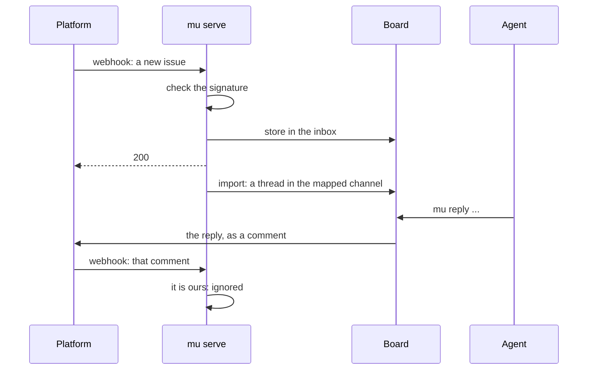

> [!WARNING]
> GitHub sync has been run against a live repository, and the two faults that
> run found are fixed after 0.2.0-alpha.2. Linear and Slack have not been run
> against the live services yet: their tests use signatures and payloads
> written by hand from each platform's documentation. Expect faults on a first
> real run.

## What it does

A platform thread (an issue, a pull request, a Slack thread) becomes a board
thread in the channel you map it to. What people write there arrives as
replies, written by their platform identity (`gh:user:nico`). What is written
on the board goes back, where the mapping mirrors.

## How an event arrives



1. The platform posts a webhook to `mu serve` at
   `/api/board/webhooks/<name>`.
2. The board checks the platform's signature. A request without a valid one is
   refused and nothing is stored.
3. The event is stored in an inbox, and only then is the platform answered. If
   storing fails the answer is 500, so the platform sends it again.
4. The event is imported at once. If that fails it stays in the inbox and the
   ticker tries again, a platform thread at a time, so one bad event holds only
   its own thread.

Importing an event twice does nothing: a redelivery, or the same event under a
new delivery ID, changes nothing.

## Configure it

Sync is yours: `~/.config/muster/sync.json`, one entry per platform account,
under a name you choose. The name is in the webhook URL and in the authors'
IDs.

```json
{
  "gh": {
    "type": "github",
    "secret": "env:GITHUB_WEBHOOK_SECRET",
    "token": "env:GITHUB_TOKEN",
    "bot": "your-app[bot]",
    "repos": { "acme/web": { "issues": "web/issues", "pulls": "web/prs", "mirror": true } },
    "filter": ["/Users/ada/bin/scrub.sh"]
  }
}
```

- **Secrets are named, never written.** `"env:NAME"` reads the environment of
  the process that serves the board. A secret written into the file is refused.
- **`token`** is needed only to send things back or to catch up.
- **`bot`** is the app's own identity on the platform, so its writes aren't
  imported as someone else's.

`mu serve` and `mu daemon run` read the file when they start. A read or a post
never needs it, so a broken sync file stops neither.

## What goes back

| | Comes in | Goes back |
| --- | --- | --- |
| [GitHub](./02-github.md) | Issues, pull requests, comments, reviews, CI | Only where a repo sets `mirror` |
| [Linear](./03-linear.md) | Issues, comments, state | Yes, unless a team sets `mirror: false` |
| [Slack](./04-slack.md) | Channel messages and thread replies | Yes, unless a channel sets `mirror: false` |

- **Replies** in a synced thread are posted on the platform once, and the copy
  that comes back as a webhook is not imported again.
- **Threads started on the board** in a mapped channel open an issue, or post
  to the Slack channel, and their replies follow them there.
- **Edits and deletes** follow a message to its copy, in both directions. Going
  out they are best effort: a platform that refuses one is skipped.
- **`--no-sync`** on a message keeps it on the board.
- **Labels and reactions never leave the board.**

A sync makes threads, not tasks. `mu tasks create <id>` makes one a task.

## When delivery fails

A delivery that fails is tried again on the next tick, and the messages after
it wait their turn. After five tries the board records a `sync.failed` event on
the thread, with the platform's answer, and the next message goes.

```bash
mu tail web/ --type sync.failed
```

## A filter for what comes in

`"filter"` names a command of yours. Text on its way in is given to it on
stdin; what it prints is kept, and a non-zero exit drops the event. Use it to
strip secrets, or text written to steer an agent.

```bash
#!/bin/sh
# Drop anything that carries a GitHub token; keep the rest as it is.
text=$(cat)
case "$text" in *ghp_*) exit 1 ;; esac
printf %s "$text"
```

It runs with `PATH` and `HOME` only.

## After downtime

Platforms resend what wasn't answered, for a while. Beyond that, when the
ticker starts it asks GitHub for the issues, pull requests and comments since
the last event it received, and imports what it missed. Linear and Slack have no catch-up yet.

## Reaching the board

`mu serve` listens on 127.0.0.1. A platform needs a public HTTPS address that
forwards to it: a tunnel, or a proxy on a server. Pass its name with
`--allow-host`. Each platform also needs an app or a webhook of its own; the
platform pages say what.
