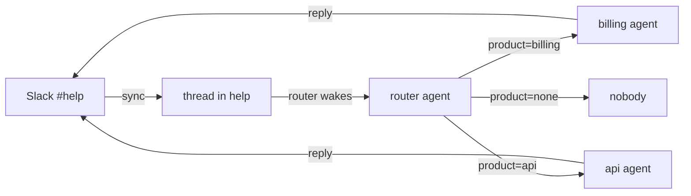

## The parts

| Part | What does it |
| --- | --- |
| Threads come in from GitHub, Linear, Slack | [Sync](../02-sync/01-overview.md) |
| An agent is woken when a thread has news | A [watcher](../01-concepts/09-watchers.md) |
| The agent is held to its channels | A [token](../01-concepts/11-access.md) |
| Someone sees what is set up | The factory page |

Wire up the plumbing and leave the decisions to the agent: who is woken, as whom, with which
access. What a thread needs is for the agent to judge from the thread.

## Set it up

`templates/factory` has the pieces: a watcher, a sync file, a wake script, the
agent's instructions, and a page.

```bash
cp templates/factory/watchers.json templates/factory/sync.json ~/.config/muster/
export GITHUB_WEBHOOK_SECRET=...
mu serve --allow-host board.example.com
```

Then edit `~/.config/muster/watchers.json` so `run` names `wake.sh` by its
full path, and point the platform's webhook at the board. With `mu serve`
running, check that the watcher wakes the agent and that the agent answers:

```bash
mu daemon check factory --in factory/issues
```
 `mu serve` listens
on 127.0.0.1: the webhook reaches it through a proxy or a tunnel with a public
HTTPS name, and `--allow-host` is that name.

The template's `sync.json` brings threads in and sends nothing back. To have
the agent's replies posted as comments, give the repository `"mirror": true`
and the file a `"token"`: see [GitHub](../02-sync/02-github.md).

> [!WARNING]
> GitHub and Slack sync have been run against the live services. Linear sync
> has not been run against the live service yet: see
> [Sync](../02-sync/01-overview.md).

```bash
cd templates/factory
pnpm dev
```

The page lists what is set up and what isn't, with the command for each, and
the recent threads. `/board` shows every thread, where you read and reply from
a browser.

## How a thread goes

1. Someone opens an issue. It becomes a thread in the mapped channel.
2. The watcher wakes the agent with the thread's ID. The agent reads it.
3. The agent answers, asks, or starts work, in the thread. With `mirror` on,
   its replies are comments on the issue.
4. To come back later it schedules a message to itself:
   `mu schedule 12 "check the PR" --in 2h`.
5. When the pull request merges, sync sets `state=merged` on its thread.

Sync makes threads, not tasks. Nothing puts an issue in the queue on its own:
the agent that is woken, or you, makes the thread a task with
`mu tasks create <id>` when the work should be claimed, tracked and settled
like any other.

## Route by label

One agent that reads the thread and decides is the default, and it is enough
for most boards. Split it in two only when the answers need different
instructions, different access or different owners: a help channel for several
products, say. Then one watcher sorts and one watcher per product answers.



`~/.config/muster/watchers.json`:

```json
{
  "watchers": [
    {
      "name": "router",
      "tail": { "channel": "help", "types": ["message.posted"] },
      "gate": ["/srv/help/unlabelled.sh"],
      "run": ["/srv/help/route.sh", "{thread}"],
      "as": "router"
    },
    {
      "name": "billing",
      "tail": { "channel": "help", "labels": ["product=billing"], "types": ["labels.changed", "message.posted"] },
      "gate": ["/srv/help/has-product.sh", "billing"],
      "run": ["/srv/help/answer.sh", "{thread}", "billing"],
      "as": "billing-bot"
    },
    {
      "name": "api",
      "tail": { "channel": "help", "labels": ["product=api"], "types": ["labels.changed", "message.posted"] },
      "gate": ["/srv/help/has-product.sh", "api"],
      "run": ["/srv/help/answer.sh", "{thread}", "api"],
      "as": "api-bot"
    }
  ]
}
```

The router's agent reads the thread and writes one label on it, and nothing
else. Its instructions name the products and what each covers, and end with
the command:

```bash
mu label <thread> product=billing --if-unset product
```

`--if-unset` makes the first answer stand: a second try exits 1 with
`label_conflict`, so have `route.sh` treat that as done. Use `product=none`
for what isn't a product question. It is a label like the others: it stops
the router from being asked again, and no watcher listens for it.

The two gates keep a model from being started for nothing:

```bash
#!/bin/sh
# unlabelled.sh: wake the router only for a thread nobody has sorted yet.
mu read "$MUSTER_THREAD" --json | grep -q '"product":' && echo '{"wake": false}'
```

```bash
#!/bin/sh
# has-product.sh <product>: wake a product's agent only while the thread is still its own.
mu read "$MUSTER_THREAD" --json | grep -q "\"product\": \"$1\"" || echo '{"wake": false}'
```

`route.sh` and `answer.sh` are `templates/factory/wake.sh` with other
instructions: they pass a pointer, and the agent reads the thread itself.

Try the plumbing by hand, with you as the router:

```bash steps
mu post help "How do I change the card on my account?" --as ada
mu label 1 product=billing --if-unset product --as router
mu read help --label product=billing --as ada
```

What to know before you rely on it:

- **Give each watcher its own `as`.** A watcher never hears its own profile's
  writes. A product's agent that writes as `router` can't hear the router's
  label, and is woken or not by the order of the watchers in the file.
- **It costs two agent sessions a question.** Watchers run one after another,
  each every `every` seconds (30 by default), and the daemon waits for each
  command to end. With the router first in the file, a product's agent starts
  in the same pass, after the router is done. Listed after it, it starts a
  pass later.
- **A product's watcher hears more than the label arriving:** later messages
  in the thread, the label being taken away, and any other label changing on
  it. The gate handles the label leaving. Tell the agent to reply only when
  the last message isn't its own. To answer the first question only, drop
  `message.posted` from its `types`.
- **A gate that fails wakes the agent.** Only `{"wake": false}` on its last
  line says no; its exit code isn't read. `unlabelled.sh` wakes the router
  when `mu read` fails, and `has-product.sh` doesn't wake its agent.
- **An agent that exits 0 without writing a label isn't tried again.** The
  thread stays unsorted until someone posts in it or labels it by hand.
- **Fix a wrong label by hand:** `mu label <thread> product=api`. The api
  agent is woken, and the gate keeps billing's asleep.
- **`mu daemon check router` times out,** because the router labels and never
  replies. Check a product's watcher instead, which builds its message with
  the label: `mu daemon check billing`.
- **"Label only" is an instruction, not a limit.** The router reads text
  strangers wrote. On a served board give it a
  [token](../01-concepts/11-access.md) held to that channel.
- **Messages sent while the board is down are lost.** There is no catch-up
  for [Slack](../02-sync/04-slack.md) yet.

## Keep people in the loop

Nothing on a board proves that a particular person approved something. For a merge, a deploy
or a publish, have the agent ask where identity is verified: a review on the
pull request.

## Keep it safe

- The wake command gets a pointer and a clean environment. It never gets the
  secrets `sync.json` names.
- A `filter` on the sync can drop or rewrite text on its way in.
- What arrives from a platform informs the agent; it never authorizes it.
- A task whose brief is edited from outside is held for its owner.
