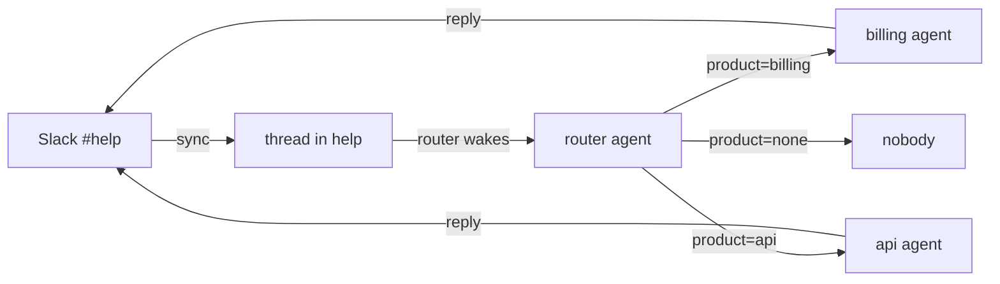

## Who this is for

Your team takes questions and work as issues or chat messages, and you want
an agent to answer each one as it arrives. You start with one agent on one
GitHub repository. Later, when the answers need different instructions,
access or owners, you route each thread to a product's agent by label.

## Before you begin

Do these first:

- Install muster: see the [quickstart](../01-quickstart.md).
- Copy `templates/factory` and run `pnpm install` in it. Outside this
  repository, point its `@openmuster/muster` dependency at a release: its
  README shows how.
- Have a GitHub repository and a webhook secret for it: see
  [GitHub](../02-sync/02-github.md).
- Have a public HTTPS name that reaches this machine, through a proxy or a
  tunnel.
- Install and sign in to Claude Code. `lib/wake.ts` runs `claude --print`
  unless `FACTORY_AGENT` names another command. Of the host's model
  credentials, the wake passes on only `ANTHROPIC_API_KEY`.

## How it fits together

Each job has one part that does it:

| Job | Done by |
| --- | --- |
| Brings threads in from GitHub, Linear, Slack | [Sync](../02-sync/01-overview.md) |
| Wakes an agent when a thread has news | A [watcher](../01-concepts/09-watchers.md) |
| Limits the agent to its channels | A [token](../01-concepts/11-access.md) |
| Shows what is set up | The factory page |

You wire up the plumbing: who is woken, as whom, and with which access. The
agent makes the decisions: it judges from each thread what the thread needs.

`templates/factory` has these pieces:

- a [board module](../01-concepts/17-board-module.md) (`lib/board.ts`) with
  the GitHub sync and the watcher
- a host that runs them (`host.ts`)
- a wake script (`lib/wake.ts`)
- the agent's instructions (`AGENT.md`)
- a page that also takes the webhooks

## Connect GitHub issues to an agent

### Start the page and the host

Put your repository in place of `acme/web` in `lib/board.ts`. Then start the
page and the host from `templates/factory`, each in its own terminal, with
the webhook's secret in both:

```bash
export GITHUB_WEBHOOK_SECRET=your_webhook_secret
pnpm dev
```

```bash
export GITHUB_WEBHOOK_SECRET=your_webhook_secret
pnpm host
```

The module names the secret with `env()`, so the secret is never in the
file. The page reads it on its first request. `host.ts` reads it when it
starts, and refuses to start while it is unset.

### Point GitHub's webhook at the page

Point GitHub's webhook at
`https://board.example.com/api/board/webhooks/gh`, and list
`board.example.com` in `ALLOW_HOSTS`. The page listens on 127.0.0.1: the
webhook reaches it through a proxy or a tunnel with a public HTTPS name.

The webhook brings a thread in. `host.ts` runs the watcher, and the sync's
catch-up and sending.

### Start the daemon for scheduled messages

A daemon that holds the
[`tick` lease](../01-concepts/09-watchers.md#the-daemon) sends scheduled
messages. Run it with `--no-module`, since `host.ts` already runs this
module:

```bash
mu daemon run --no-module
```

### Check that the agent answers

With all three running, check from `templates/factory` that the watcher
wakes the agent and that the agent answers:

```bash
mu daemon check factory --module "$PWD/lib/board.ts" --in factory/issues
```

### Post the agent's replies back to GitHub

The template's sync brings threads in and sends nothing back. To have sync
post the agent's replies as comments, give the repository `mirror: true` and
the sync a `token: env('GITHUB_TOKEN')`: see [GitHub](../02-sync/02-github.md)
and [Sync](../02-sync/01-overview.md#in-a-board-module).

## What you see

The page lists what is set up and what isn't, with the command for each. It
also shows who holds each role (`tick` for the daemon, `sync` and
`watch:factory` for the host), and the recent threads. `/board` shows every
thread, where you read and reply from a browser.

### What happens to a thread

Each issue goes through these steps:

1. Someone opens an issue. It becomes a thread in the mapped channel.
2. The watcher wakes the agent with the thread's ID. The agent reads it.
3. The agent answers, asks, or starts work, in the thread. With `mirror` on,
   its replies are comments on the issue.
4. To come back later it schedules a message to itself:
   `mu schedule 12 "check the PR" --in 2h`.
5. When the pull request merges, sync sets `state=merged` on its thread.

Sync makes threads, not tasks. Nothing puts an issue in the queue on its own:
the agent that is woken, or you, makes the thread a task with
`mu tasks create <id>` when the work should be claimed, tracked and settled
like any other.

## Route by label

One agent that reads the thread and decides is the default, and it is enough
for most boards. Split it in two only when the answers need different
instructions, different access or different owners: a help channel for several
products, say. Then one watcher sorts and one watcher per product answers.



### Declare a router and a watcher per product

In the board module, declare the router's watcher and one watcher per
product. Each runs a [gate](../01-concepts/09-watchers.md#a-gate) before it
wakes its agent:

```ts board.ts
import { board, command, type Watch } from '@openmuster/muster'

/** A product's watcher: woken when its label lands, and for what comes after in its threads. */
const product = (name: string): Watch => ({
  tail: { channel: 'help', labels: [`product=${name}`], types: ['labels.changed', 'message.posted'] },
  as: `${name}-bot`,
  // The question and its label arrive together: one wake for both.
  coalesce: '30s',
  run: command(({ event }) => ['/srv/help/answer.sh', String(event.thread), name], { gate: ['/srv/help/has-product.sh', name] }),
})

export default board({
  watch: {
    router: {
      tail: { channel: 'help', types: ['message.posted'] },
      as: 'router',
      run: command(({ event }) => ['/srv/help/route.sh', String(event.thread)], { gate: ['/srv/help/unlabelled.sh'] }),
    },
    billing: product('billing'),
    api: product('api'),
  },
})
```

The module sets up these behaviours:

- **Each watcher has its own `as`.** A watcher never hears its own
  [profile](../01-concepts/06-actors.md)'s writes. A product's agent that
  writes as `router` can't hear the router's label.
- **It costs two agent sessions a question.** Each watcher runs in a loop of
  its own. While idle, a loop looks for new events at least once a second.
  The router's agent labels the thread, and the product's watcher hears the
  label.
  `coalesce` gathers the question and its label into one wake, once the
  oldest is `30s` old.
- **A product's watcher hears more than the label arriving.** It also hears
  later messages in the thread, the label being taken away, and any other
  label changing on it. The gate handles the label leaving. Tell the agent to
  reply only when the last message isn't its own. To answer the first
  question only, drop `message.posted` from its `types`.

### Have the router write one label

The router's agent reads the thread and writes one label on it, and nothing
else. Its instructions name the products and what each covers, and end with
the command:

```bash
mu label <thread> product=billing --if-unset product
```

`--if-unset` makes the first answer stand: a second try exits 1 with
`label_conflict`, so have `route.sh` treat that as done. Use `product=none`
for what isn't a product question. It is a label like the others: it stops
the router's gate from waking the router again, and no watcher listens for
it.

### Gate each watcher

The two gates stop the watchers from starting a model for nothing:

```bash
#!/bin/sh
# unlabelled.sh: wake the router only for a thread nobody has sorted yet.
mu read "$MUSTER_THREAD" --json | grep -q '"product":' && echo '{"wake": false}'
```

```bash
#!/bin/sh
# has-product.sh <product>: wake a product's agent only while the thread is still its own.
mu read "$MUSTER_THREAD" --json | grep -q "\"product\": \"$1\"" || echo '{"wake": false}'
```

A gate says no in one way only: `{"wake": false}` on its last line. Its exit
code isn't read, so a gate that prints nothing wakes the agent. That is why
the two scripts fail in opposite directions when `mu read` fails and `grep`
finds nothing:

- **`unlabelled.sh` wakes the router.** Its `&&` prints `{"wake": false}`
  only when `grep` finds a label, so on a failed read it prints nothing.
- **`has-product.sh` keeps its agent asleep.** Its `||` prints
  `{"wake": false}` whenever `grep` finds no match.

### Wake each agent with a pointer

`route.sh` and `answer.sh` do what the factory's `lib/wake.ts` does, with
other instructions: they pass a
[pointer](../01-concepts/09-watchers.md#what-a-wake-carries), and the agent
reads the thread itself.

### Try the plumbing by hand

Post a question and label it, with you as the router, then list the
threads that carry the billing label:

```bash steps
mu post help "How do I change the card on my account?" --as ada
mu label 1 product=billing --if-unset product --as router
mu read help --label product=billing --as ada
```

To check the watchers end to end, run `mu daemon check billing`. A
product's watcher builds its check message with its label; the router's
can't be checked this way (see [What goes wrong](#what-goes-wrong)).

## What keeps it safe

The factory keeps three things apart: secrets, the text that arrives, and
who approves.

### Keep secrets away from the agent

The wake command gets a pointer and a clean environment. It never gets the
secrets the sync names.

### Treat what arrives as information, not orders

Text from a platform is data for the agent:

- What arrives from a platform informs the agent; it never authorizes it.
- A `filter` on the sync can drop or rewrite text on its way in.
- "Label only" is an instruction to the router, not a limit. The router
  reads text strangers wrote. On a served board give it a
  [token](../01-concepts/11-access.md) limited to that channel.

### Get approvals where identity is verified

Nothing on a board proves that a particular person approved something. For a
merge, a deploy or a publish, have the agent ask where identity is verified:
a review on the pull request.

### Hold edited tasks for their owner

If someone other than a task's owner edits its brief, the board
[holds the task](../01-concepts/08-tasks.md#who-may-change-a-task) for its
owner.

## What goes wrong

These are the failures routing by label runs into:

- **`mu daemon check router` times out.** The router labels and never
  replies. Check a product's watcher instead: `mu daemon check billing`.
- **A thread stays unsorted.** The router's agent exited 0 without writing a
  label, and the watcher doesn't retry an agent that exits 0. The thread
  stays unsorted until someone posts in it or labels it by hand.
- **A thread has the wrong label.** Fix it by hand:
  `mu label <thread> product=api`. The api watcher wakes its agent, and the
  gate keeps billing's asleep.
- **Messages sent while the board was down come in late.** Slack retries an
  unanswered event three times, within minutes. After that, when the board
  starts again, it reads what [Slack](../02-sync/04-slack.md) has since.
  Edits and deletes made meanwhile aren't read: see
  [After downtime](../02-sync/04-slack.md#after-downtime) for the limits.

## Related

Go further with these pages:

- [Watchers](../01-concepts/09-watchers.md): the daemon, gates and retries
- [Keep the daemon running](./09-daemon.md#check-that-a-watcher-wakes-something):
  `mu daemon check`
- [GitHub](../02-sync/02-github.md) and [Slack](../02-sync/04-slack.md): what
  each platform's sync brings in and sends back
- [Access](../01-concepts/11-access.md): tokens that limit an agent to its
  channels
