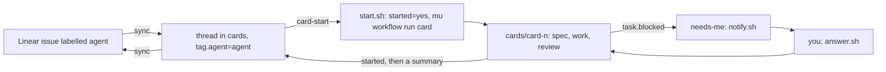

## Who this is for

You keep work as cards, Linear issues or threads you post yourself, and want
an agent to take a card from start to finish: write a spec, make the change
as a pull request, and review it. You only want to hear about a card when the
agent needs a decision from you.

**You need:** muster on the machine that holds the board, `mu serve` reached
through a tunnel or a proxy, a Vercel project for the sandboxes, a GitHub App
installed on the repository, a model key, and for Linear cards a Linear key
and webhook. See [Agents in cloud sandboxes](./06-sandboxed-agents.md) for
the Vercel and GitHub parts.

## The parts

`templates/queue` is configuration for muster's own daemon and three small
scripts:

| File | What it does |
| --- | --- |
| `sync.json` | Linear team `ENG` to the channel `cards`, both ways |
| `watchers.json` | `card-start` runs `start.sh` for a card labelled `tag.agent=agent`; `needs-me` runs `notify.sh` when a task under `cards/` blocks |
| `workflows.json` | The `card` workflow: spec, work and review tasks, one Vercel worker, `--push` |
| `start.sh` | Marks the card `started` and asks for the `card` workflow on it, once |
| `notify.sh` | Tells you a task is blocked, with its ID only |
| `answer.sh` | Unblocks a blocked task, posts your answer, and starts a worker on the rest of its run |



## Set it up

```bash
cp templates/queue/sync.json templates/queue/watchers.json templates/queue/workflows.json ~/.config/muster/
```

Then edit the copies:

- `watchers.json`: make `./start.sh` and `./notify.sh` the full paths of the
  scripts in `templates/queue`.
- `workflows.json`: `repo` is your repository's https address.
- `sync.json`: `ENG` is your Linear team's key.

Put the settings in the environment `mu serve` starts with. Its ticker runs
the watchers and the workflow, and the workers start with its environment:

```bash
export LINEAR_WEBHOOK_SECRET=...  LINEAR_API_KEY=lin_api_...
export MUSTER_SANDBOX_URL=https://board.example.com/api/board
export VERCEL_TOKEN=... VERCEL_TEAM_ID=... VERCEL_PROJECT_ID=...
export GITHUB_APP_ID=123456 GITHUB_APP_KEY_FILE=~/.config/muster/app.pem
export ANTHROPIC_API_KEY=sk-ant-...
mu serve --allow-host board.example.com
```

Use `MUSTER_SANDBOX_URL`, not `MUSTER_URL`. The watchers' scripts run `mu` on
the board's file here; with `MUSTER_URL` set they would go to the server
instead, with no token, and be refused. Point Linear's webhook at
`https://board.example.com/api/board/webhooks/lin`, as
[Linear](../02-sync/03-linear.md) says, and cap what the cards may cost:

```bash
mu budget cards 10
mu workflow list
```

## How a card goes

1. An issue in the team gets the label `agent`, when it is made or later. It
   arrives as a thread in `cards` with `tag.agent=agent`.
2. Within 30 seconds the watcher `card-start` runs `start.sh` with the
   thread's ID, as the profile `intake`. The script sets `started=yes` on the
   card only if it still has `tag.agent=agent` and has no `started`, in one
   write, and then asks for the `card` workflow on it. Any later wake, from a
   comment or the daemon's own reply, finds `started` set and does nothing.
3. The daemon makes three tasks in `cards/card-<n>`: `spec`, `work`, which
   needs the spec, and `review`, which needs the work. The spec task quotes
   the card's text as content, not instructions. One worker takes them in
   turn, each in its own Vercel sandbox; the work task's change is pushed to
   `mu/task-<id>` and opened as a pull request.
4. The card gets two replies, which go to Linear as comments: `started card:
   3 tasks in cards/card-<n>`, and once the tasks have ended, a summary with
   each task's result and the pull request.

The run's tasks are not sent to Linear: only `cards` is mapped, and
`cards/card-<n>` is another channel.

## A card you post yourself

A card needs no issue. Post it with the label, and with `--no-sync`, so it
doesn't open an issue in Linear: that issue would have no `agent` label, and
its next update would take `tag.agent` off the card.

```bash steps
mu post cards "Make the footer show the current year" --label tag.agent=agent --no-sync
mu read cards --label tag.agent=agent
```

This is what `start.sh` writes as its gate. Written a second time it fails
with `label_conflict`, which is how the script knows the card has started:

```bash steps
mu label 1 started=yes --if tag.agent=agent --if-unset started --as intake
```

## When it needs you

A worker that can't go on without a decision blocks its task with one line on
where things stand, then `->`, the decision it needs and what it recommends.
The watcher `needs-me` runs `notify.sh` with the task's ID: a macOS
notification, or, with `NOTIFY_CMD` in the daemon's environment, your own
command, given one line. Neither gets anything the task says.

```bash
mu read 14
./answer.sh 14 "SSO first."
```

`answer.sh` unblocks the task, then posts your answer on it. The unblock is
the gate: of two answers to one task, only the one whose unblock changed it
goes on, and an answer the board refuses posts nothing. Then, since the run's
own worker stops after ten idle minutes, it starts a worker that takes the
run's ready tasks one after another, the answered one first, held to that
run's tasks as the daemon's workers are: same runner, agent, repository and
`--push` as `workflows.json`. It starts none while a worker of the run is
still going on this machine; that one takes the task.

Run it as yourself, with no `--as` and no `MUSTER_PROFILE`: the run's tasks
are the daemon's, and only the board's owner with no profile may unblock
them. Run it where `mu serve` runs, with the same `MUSTER_SANDBOX_URL`,
Vercel, GitHub App and model settings in your shell: it starts the worker
itself, and stays until the worker ends, since a `--push` run's change is
pushed from here. If the worker ends badly, the script prints the `mu run`
line that runs what is left.

## When not to

- For work that needs a back-and-forth: the steps are fixed, spec, work and
  review, and the review only comments. Nothing is sent back for a second
  round.
- For a card whose text you wouldn't hand a stranger's agent: see below.
- For a board other people's agents reach with tokens: the watchers run on
  the board's own machine, as its owner.

## What a card can reach

A card's text is written by whoever filed it, and it steers agents that can
push. Know what a run reaches before you map a team:

- **Who starts one.** Anyone who can label an issue in the mapped team, or
  post or label a thread in `cards`, starts a run. The run is asked for by
  `intake`, the watcher's profile, so the workflow's `who` doesn't check the
  card's author.
- **The repository.** Every step's sandbox may push: a step's change goes to
  `mu/task-<id>` in the workflow's repository, with a pull request. The
  workflow format sets `push` for all of a workflow's workers, not per step,
  so the spec and review steps can push too, though they are told to change
  nothing.
- **CI.** That pull request runs your CI on the agent's code, with whatever
  secrets CI gives a branch of the same repository. Keep secrets away from
  pull-request jobs, or require approval before they run.
- **Linear.** The run's summary quotes each task's result, which an agent
  wrote from the card, as a comment on the issue, where its author reads it.
- **What it can't reach.** The sandbox holds no board credential of yours, no
  GitHub token and no model key; its token reaches the run's channel only.

The spec task quotes the card as content, defused. Later steps read the spec
task's result, which an agent wrote from the card; their text tells them it
is a description of a change, not instructions, but nothing fences it the
way the card's text is fenced.

## What goes wrong

- **The request fails.** `start.sh` leaves `started` set, so a request that
  went through before the error doesn't start a second run, and replies on
  the card, on the board only, with the retry: `mu label <id> --unset started`.
  If the daemon refuses the request, it says why on the card itself.
- **A label taken off.** Before the watcher looked, nothing starts. After a
  run started, it goes on: cancel its tasks with `mu tasks cancel`.
- **The board was down.** With the key in `sync.json`, `mu serve` catches up
  when it starts again: an issue made meanwhile arrives with its labels, and
  an `agent` label added meanwhile to a card it has is brought in, and either
  starts the card, whatever state the issue is in, closed included: the
  budget on `cards` is the cap. Without a key there is no catch-up: an issue
  made while the board was down never arrives, and a label added meanwhile
  to a card it has arrives with the issue's next update.
- **An issue from before sync was set up.** Linear's webhook for a label
  added to it is dropped, since the board never saw the issue: see
  [Linear](../02-sync/03-linear.md). Make a new issue instead.
- **A long card.** The spec task quotes the first 2,000 characters.
- **Files on a card** don't reach the sandbox: the worker's token reaches
  the run's channel only.
- **The review sees no checkout of the change.** Its sandbox clones the
  default branch, and the pushed branch isn't there. The work step attaches
  its diff to a reply on its task, and the review reads that; if the work
  step didn't, the review says so and reviews nothing.
- **A label write whose answer was lost.** Over HTTP, `start.sh`'s label is
  keyed by the event that woke it, so the daemon's retry gets the same
  answer and the card still starts. If new activity lands on the card before
  that retry, the retry has another key and finds `started` set: start it
  with `mu label <id> --unset started`.
- **A usage limit.** The worker stops and the task fails; the summary says so.
- **`answer.sh` says `isn't yours to change`.** It ran with a profile: unset
  `MUSTER_PROFILE`.

## Not tried live

The template is covered by tests: a Linear issue starting a run through the
real watcher, script and daemon, with workers and Linear's API as
stand-ins. It has not been run against Linear, Vercel and GitHub together.
