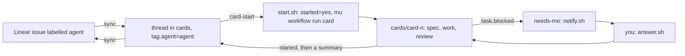

## Who this is for

You keep work as cards: Linear issues, or threads you post yourself. You
want an agent to take a card from start to finish: write a spec, make the
change as a pull request, and review it. You only want to hear about a card
when the agent needs a decision from you.

You need:

- muster on the machine that holds the board
- `mu serve` reached through a tunnel or a proxy
- a Vercel project for the sandboxes
- a GitHub App installed on the repository
- a model key
- for Linear cards, a Linear key and webhook

See [Agents in cloud sandboxes](./06-sandboxed-agents.md) for the Vercel and
GitHub parts. `"runner": "e2b"` in `workflows.json` runs the steps in E2B
sandboxes instead, with `E2B_API_KEY` and `MUSTER_E2B_TEMPLATE` in place of
the Vercel settings.

## Files in the queue template

`templates/queue` is a [board module](../01-concepts/17-board-module.md), a
workflow file, and three scripts:

| File | What it does |
| --- | --- |
| `board.ts` | The board module. Its sync maps Linear team `ENG` to the channel `cards`, both ways. Its [watcher](../01-concepts/09-watchers.md#watchers) `card-start` runs `start.sh` for a card labelled `tag.agent=agent`; `needs-me` runs `notify.sh` when a task under `cards/` [blocks](../01-concepts/08-tasks.md#states) |
| `workflows.json` | The `card` workflow: spec, work and review tasks, one Vercel worker, `--push` for the work step only |
| `start.sh` | Marks the card `started` and asks for the `card` workflow on it, once |
| `notify.sh` | Tells you a task is blocked, with its ID only |
| `answer.sh` | Unblocks a blocked task, posts your answer, and starts a worker on the rest of its run |



## Set it up

Copy the workflow file to muster's config folder:

```bash
cp templates/queue/workflows.json ~/.config/muster/
```

Then edit the copy: `repo` is your repository's https address. In
`board.ts`, `ENG` is your Linear team's key. `board.ts` stays in
`templates/queue`, and names the scripts beside it by their full paths,
wherever it is run from.

Put the settings in the environment `mu serve` starts with, and give it the
module. `mu serve` runs the module's sync, its watchers and the workflow, and
the workers start with its environment. The module names the Linear secrets
with `env()`. `mu serve` reads them when it starts. If one isn't set, it
refuses to start and names the variable:

```bash
export LINEAR_WEBHOOK_SECRET=your_linear_webhook_secret  LINEAR_API_KEY=your_linear_api_key
export MUSTER_SANDBOX_URL=https://board.example.com/api/board
export VERCEL_TOKEN=your_vercel_token VERCEL_TEAM_ID=your_vercel_team_id VERCEL_PROJECT_ID=your_vercel_project_id
export GITHUB_APP_ID=123456 GITHUB_APP_KEY_FILE=~/.config/muster/app.pem
export ANTHROPIC_API_KEY=your_anthropic_api_key
mu serve --module "$PWD/templates/queue/board.ts" --allow-host board.example.com
```

Use `MUSTER_SANDBOX_URL`, not `MUSTER_URL`. The watchers' scripts run `mu`
against the board's file on this machine; with `MUSTER_URL` set they would go
to the server instead, with no token, and be refused. Point Linear's webhook
at `https://board.example.com/api/board/webhooks/lin`, as
[Linear](../02-sync/03-linear.md) says. Then cap what the cards may cost at
$10, and check that the `card` workflow is listed:

```bash
mu budget cards 10
mu workflow list
```

## How a card goes

Each card goes through these steps:

1. An issue in the team gets the label `agent`, when it is made or later.
   Sync brings it in as a thread in `cards` with `tag.agent=agent`.
2. Within a few seconds the watcher `card-start` runs `start.sh` with the
   thread's ID, as the [profile](../01-concepts/06-actors.md) `intake`. The
   script sets `started=yes` on the card only if it still has
   `tag.agent=agent` and has no `started`, in one write. Then it asks for the
   `card` workflow on it. Any later wake, from a comment or the run's own
   reply, finds `started` set and does nothing.
3. `mu serve` makes three tasks in `cards/card-<n>`: `spec`, `work`, which
   needs the spec, and `review`, which needs the work. The spec task quotes
   the card's text as content, not instructions. The work and review tasks
   quote the spec's result the same way, and the review task also quotes the
   work's summary. The worker fills each quote in when it takes the task. One
   worker takes the tasks in turn, each in its own Vercel sandbox. Only the
   work task's change is pushed to `mu/task-<id>` and opened as a pull
   request.
4. The card gets two replies, which go to Linear as comments: `started card:
   3 tasks in cards/card-<n>`, and once the tasks have ended, a summary with
   each task's result and the pull request. On the board the first reply also
   says where each task is, as the run goes. Linear keeps it as it was first
   written, since edits don't go to Linear.

Sync doesn't send the run's tasks to Linear: only `cards` is mapped, and
`cards/card-<n>` is another channel.

## A card you post yourself

A card needs no issue. Post it with the label, and with `--no-sync`, so it
doesn't open an issue in Linear: that issue would have no `agent` label, and
its next update would take `tag.agent` off the card.

```bash steps
mu post cards "Make the footer show the current year" --label tag.agent=agent --no-sync
mu read cards --label tag.agent=agent
```

This is what `start.sh` writes as its gate. Written a second time it fails
with `label_conflict`, which is how the script knows the card has started:

```bash steps
mu label 1 started=yes --if tag.agent=agent --if-unset started --as intake
```

## When it needs you

A worker that can't go on without a decision blocks its task with one line on
where things stand, then `->`, the decision it needs and what it recommends.
The watcher `needs-me` runs `notify.sh` with the task's ID: a macOS
notification, or, with `NOTIFY_CMD` in `mu serve`'s environment, your own
command, given one line. Neither receives any of the task's text.

```bash
mu read 14
./answer.sh 14 "SSO first."
```

`answer.sh` unblocks the task, then posts your answer on it. The unblock is
the gate: of two answers to one task, only the one whose unblock changed it
goes on, and an answer the board refuses posts nothing.

Then `answer.sh` starts a worker, since the run's own worker stops after 10
idle minutes. That worker takes the run's ready tasks one after another, the
answered one first. It is limited to that run's tasks, as the workers
`mu serve` starts are, with the same runner, agent, repository and `--push`
as `workflows.json`. `answer.sh` starts none while a worker of the run is
still going on this machine; that one takes the task.

Run it as yourself, with no `--as` and no `MUSTER_PROFILE`: `mu serve` makes
the run's tasks as the profile `workflows`, and only the board's owner with
no profile may unblock them. Run it where `mu serve` runs, with the same
`MUSTER_SANDBOX_URL`, Vercel, GitHub App and model settings in your shell. It
starts the worker itself, and stays until the worker ends, since a `--push`
run's change is pushed from here. If the worker ends badly, the script prints
the `mu run` line that runs what is left.

## When not to use a card queue

These cases need something else:

- For a project you plan and iterate on in Linear, with rounds on the same
  pull request: [Building from Linear](./22-building-from-linear.md).
- For work that needs a back-and-forth: the steps are fixed, spec, work and
  review, and the review only comments. Nothing is sent back for a second
  round.
- For a card whose text you wouldn't hand a stranger's agent: see
  [What a card can reach](#what-a-card-can-reach).
- For a board other people's agents reach with tokens: the watchers run on
  the board's own machine, as its owner.

## What a card can reach

Whoever files a card writes its text, and agents that can push act on it.
Know what a run reaches before you map a team:

- **Who starts one:** anyone who can label an issue in the mapped team, or
  post or label a thread in `cards`, starts a run. `intake`, the watcher's
  profile, asks for the run, so the workflow's `who` doesn't check the card's
  author.
- **The repository:** the work step's sandbox pushes its change to
  `mu/task-<id>` in the workflow's repository, with a pull request. The spec
  and review steps set `push: false`, so whatever their agents change is
  never pushed. The worker reads that from what `mu serve` made each task
  with, never from its labels now, so an agent that relabels a task changes
  nothing.
- **CI:** that pull request runs your continuous integration (CI) on the
  agent's code, with whatever secrets CI gives a branch of the same
  repository. Keep secrets away from pull-request jobs, or require approval
  before they run.
- **Linear:** the run's summary quotes each task's result, which an agent
  wrote from the card, as a comment on the issue, where its author reads it.
- **What it can't reach:** the sandbox holds no board credential of yours, no
  GitHub token and no model key; its token reaches the run's channel only.

The spec task quotes the card as content, defused. The spec's result was
written by an agent that read the card. So the work and review tasks quote it
the same way, with `{steps.spec.result}`: under a line that says whose it is,
in a fence nothing in it can close, with `@`, `<`, `>` and Markdown links
defused. The review quotes the work's summary too.

A fence marks what is content; it can't stop an agent from following
instructions in it anyway. Three things still reach a later step unfenced:

- the work's diff, which the review downloads and reads
- anything an agent chooses to read itself with `mu read`
- a later task's own text, which an earlier step's agent may edit, since its
  token may post in the run's channel

When an agent edits a later task, the board
[holds](../01-concepts/08-tasks.md#who-may-change-a-task) that task as
`edited`, and `needs-me` pings you. `answer.sh` won't answer it: read what
changed, and unblock it yourself only if it is safe. Even then its worker
doesn't fill results into text it didn't write, and holds it again as
`workflow.edited`.

A task quotes a step's result only when the run's own worker completed that
step. An agent that claimed and completed another step itself, with its
sandbox's token, gets a `no result` note in the next task instead. A task
quotes a result once, when it is first taken: a task reopened after a step
it quotes was done again keeps the old quote.

## What goes wrong

The failures you may hit, and what to do:

- **The request fails.** `start.sh` leaves `started` set, so a request that
  went through before the error doesn't start a second run, and replies on
  the card, on the board only, with the retry: `mu label <id> --unset started`.
  If `mu serve` refuses the request, it says why on the card itself.
- **Someone takes the label off.** Before the watcher looked, nothing starts.
  After a run started, it goes on: cancel its tasks with `mu tasks cancel`.
- **A script keeps failing.** The watcher tries the same event again, with a
  growing wait, and after 5 tries says so on the card or task, once.
- **The board was down.** With `LINEAR_API_KEY` set, `mu serve` catches up
  when it starts again. An issue made meanwhile arrives with its labels. An
  `agent` label added meanwhile to a card the board already has is brought
  in. Either one starts the card, whatever state the issue is in, closed
  included: the budget on `cards` is the cap. Without a key there is no
  catch-up. An issue made while the board was down never arrives, and a label
  added meanwhile to a card the board has arrives with the issue's next
  update.
- **An issue was made before sync was set up.** Labelling it `agent` starts
  the card: Linear's update includes the whole issue, so its thread starts
  with the title, description and labels, as a new issue's would. If someone
  commented on it first, after sync was set up, the thread started from that
  comment, which includes only the title: the card then runs on the title
  alone. See [Linear](../02-sync/03-linear.md#an-issue-from-before-sync).
- **A card is long.** The spec task quotes the first 2,000 characters.
- **A step completes with no result.** The next task says so where the result
  would be: `(No result from step "spec", #12: it completed without one.)`.
- **The worker can't fill a task.** If the quoted results make its text
  longer than the board takes, the worker fails the task with `couldn't
  quote the earlier steps' results into it`, and runs no agent on it.
- **Files on a card don't reach the sandbox.** The worker's token reaches
  the run's channel only.
- **The review sees no checkout of the change.** Its sandbox clones the
  default branch, and the pushed branch isn't there. The work step attaches
  its diff to a reply on its task, and the review reads that; if the work
  step didn't, the review says so and reviews nothing.
- **A label write's answer is lost.** Over HTTP, `start.sh`'s label is keyed
  by the event that woke it, so the watcher's retry gets the same answer and
  the card still starts. If new activity arrives on the card before that
  retry, the retry has another key and finds `started` set: start it with
  `mu label <id> --unset started`.
- **The agent reaches a usage limit.** The worker stops and the task fails;
  the summary says so.
- **`answer.sh` says `isn't yours to change`.** It ran with a profile: unset
  `MUSTER_PROFILE`.
- **`mu serve` refuses to start with `config_retired`.** `~/.config/muster/`
  has a `watchers.json`, `sync.json` or `hooks.json` from an earlier copy of
  this template. Those files are no longer read: move anything else in them
  into a board module and delete them
  ([Porting](../04-reference/07-porting.md)).

## What has been tested

Experimental: not yet run end to end against Linear, Vercel and GitHub
together.
