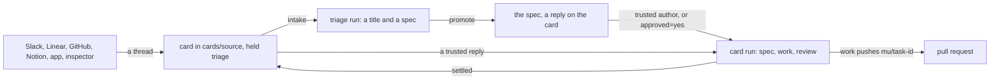

## Who this is for

You build something with agents and want to steer it from wherever you are:
a report in Slack, a Linear issue, a Notion page, a button in the app
itself. Each report should become a card with a proper title and spec. The
change should come back as a pull request with screenshots. A reply on the
card should start another round, on the same pull request, until it is
right.

**You need:** what [A card queue](./19-a-card-queue.md) needs (muster where
the board is, `mu serve` behind a tunnel or a proxy, a Vercel project for the
sandboxes, a GitHub App on the repository, a model key), and the keys for
the sources you sync.

## How it fits together

`templates/loop` is a [board module](../01-concepts/17-board-module.md) and a
workflow file:



- **A card is a thread and a task.** Its
  [hold](../01-concepts/08-tasks.md#states) (the kind of block on its task)
  says where it is:
  - `backlog`: [parked](../01-concepts/08-tasks.md#parking-work-for-later),
    and nothing runs until it is moved to ready
  - `planning`: an agent shapes it with you
  - `triage`: an agent is turning the report into a spec
  - `approval`: the spec is on the card, and the report's author isn't
    trusted
  - `working`: the `card` workflow is making the change, as a pull request
  - `duplicate`: the triage found the same request on another card
  - `declined`: the triage made no card
  - `done`: its run was approved but it couldn't be completed
  - `edited`: its author changed the report
- **Each source has its own channel.** The channels are under `cards/`:
  `cards/slack`, `cards/linear`, `cards/github`, `cards/notion`,
  `cards/app`. A card's runs are in channels under the card's own, so the
  card is what Slack and Linear mirror.
- **The triage agent writes the card.** It reads the report and the
  repository, changes nothing, and completes with a title on the first line,
  then what to change and how to check it. The spec goes on the card as a
  reply, written as `triage`, only when the triage run's own worker completed
  it.
- **The card run quotes that reply.** It quotes it with `{on.text}`, fenced
  as content, not instructions. Only the triage step reads the report.

## Set it up

Copy the workflows, set who is trusted, and start the board with the loop's
module:

```bash
cp templates/loop/workflows.json ~/.config/muster/
export LOOP_TRUSTED=slack:user:U0123,lin:user:3f2a9c1e-4b7d-4e0a-9a51-7c2d8e6b1f03
mu serve --module "$PWD/templates/loop/board.ts" --allow-host board.example.com
```

Replace the IDs in `LOOP_TRUSTED` with your own:
[Who may start work](#who-may-start-work) says how to write one.

Edit `board.ts` for your Slack channel's ID, your Linear team's key and your
repository, and `workflows.json` for your repository. Put the settings in the
environment `mu serve` starts with, as for
[a card queue](./19-a-card-queue.md#set-it-up), with the secrets `board.ts`
names in `env()`.

## Who may start work

`LOOP_TRUSTED` is a comma-separated list of actor IDs. A Slack user is
`<sync key>:user:<their ID>`. An app posting with a token you made is
`<your principal>+<its profile>`
([principals and profiles](../01-concepts/06-actors.md#principals-and-profiles)).
You, as yourself with no profile, are always trusted. The loop reads the
list each time a card moves, so a change takes effect at once.

How the loop uses it:

- **A trusted author's report needs no approval.** Its work starts as soon
  as the triage writes the spec, as long as the report is as they first
  wrote it.
- **Anyone else's report waits.** The card is held `approval`, and the loop
  tells you. Someone trusted labels it `approved=yes`
  (`mu label 12 approved=yes`, or in the [inspector](./04-inspector.md)). A
  label by anyone else does nothing.
- **An author the sync couldn't name is never trusted.** Nor is a GitHub
  author: GitHub's sync names one by login, which can change hands, so a
  GitHub issue always waits for an approval.
- **The work never reads the report.** The card run quotes the spec the
  triage wrote (and someone approved, where it had to be) with `{on.text}`,
  never the report itself.

## Stages

A card starts where its source says. The loop triages only a ready card; a
parked one waits, and nothing runs for it. The stages, by source:

| Stage | Notion Status | Linear state | Anywhere else: `stage` label | The card |
| --- | --- | --- | --- | --- |
| backlog | Not started | Backlog | `stage=backlog` | held `backlog` |
| planning | Planning | Triage | `stage=planning` | held `planning`, with a planner |
| ready | Ready | Todo | `stage=ready`, or none | triaged, then `approval` or `working` |
| working | In progress, written by the loop | In Progress, written by the loop | | held `working` |
| done | Done, written by the loop | Done, written by the loop | | completed |
| canceled | | Canceled, Duplicate | | canceled |

How the stages behave:

- **The source's status moves the card.** Move a Notion page to Ready, or a
  Linear issue to Todo, and the loop triages its card. Move it back to Not
  started or Backlog and the loop parks it again, unless a run is going:
  then it stays `working`, and the card says so.
- **Only the source's own sync moves it.** The loop reads a card's source
  from how the board recorded its first message, never from a label. A
  `state` label anyone else sets moves nothing, and is never read later.
- **Cards from sources without a status are ready when they come in.** These
  sources are Slack, GitHub, your app and the inspector. Someone trusted
  parks one with `mu label 12 stage=backlog`, and starts it with
  `stage=ready`. Anyone else's `stage` label does nothing.
- **A status the loop doesn't know parks the card.**
- **The loop writes the status back.** It writes In progress when the work
  starts, and Done when the review completes with `approve`, which also
  completes the card. When a write fails, the loop says so on the card, as
  `loop`, and the card goes on. Notion's integration needs the "Update
  content" capability for it.
- **The loop writes Linear's status as the sync's OAuth app.** That is the
  app the sync comments as (`LINEAR_CLIENT_ID`, `LINEAR_CLIENT_SECRET`), even
  when a `LINEAR_API_KEY` is also set. With no app, the loop writes it with
  that key.
- **A sync given its own `scopes` needs the same `scopes` in its `SOURCES`
  entry.** The loop asks for the app's token with its sync's scopes. Linear
  revokes an app's earlier tokens, the sync's among them, when one is asked
  for with other scopes.
- **A parked card that is edited stays parked.** When it is moved to ready,
  the loop triages it from its new text.

The mapping is `SOURCES` in `board.ts`, by sync key. To replace an entry, set
`LOOP_STAGES` to JSON in the same shape:

```bash
export LOOP_STAGES='{"nt":{"type":"notion","token":"NOTION_TOKEN","stages":{"inbox":"backlog","go":"ready"},"write":{"working":"doing","done":"shipped"}}}'
```

## Plan a card with an agent

A card in planning gets an agent that shapes it with the people who asked,
before anything is built. This is the `planning` workflow: one step that
reads the report and the repository and changes nothing. How planning
works:

- **It answers on the card, as `planner`.** The answer gives its questions,
  numbered, then the card as it stands (a title, what to change, how to
  check it). It also says how it would split a change too big for one pull
  request.
- **Each trusted reply is its next round, on the same task.** The loop sends
  it the comments, fenced as content, and it answers again. Replies made
  while it works wait for its answer. Anyone else's replies aren't shown to
  it.
- **Move it to ready when the card is right.** Use Ready, Todo, or
  `stage=ready`. The triage writes the spec from the newest plan and what was
  said on the card since it. What was said in planning starts no round of
  the work.
- **Editing the report in planning starts a new planner.** It starts from
  the new text, and the triage never sees the old plan.
- **Each card has one planner.** When the card moves back to planning later,
  its planner goes on when someone replies.

## Related and duplicate cards

The loop shows each triage the other cards, newest first: each one's number,
hold and first line. It shows as many as fit in what a run quotes: 2,000
characters, after the plan when there is one. The list is a reply on the
card, written as `cards`, and stays on the board: it never reaches Slack,
Linear or Notion. The triage step quotes it with `{on.text}`, as content.

How related and duplicate cards work:

- **Related:** when a triage result starts with `related: #36, #16`, the
  loop labels the card `related=36,16` and says so on the card. It names the
  other cards by number only: the card is mirrored where it came from, and
  another card's words may be private to its own source. When both cards are
  Linear issues of the same sync, the loop relates the issues in Linear too.
- **The same request:** when a result starts with `duplicate-of: #36`, the
  loop holds the card `duplicate`, with its spec on it, and tells you.
  Someone trusted labels it `approved=yes` to work it anyway, or you cancel
  it. When a duplicate the triage wrote no card for is moved to ready, the
  loop triages it again.
- **A public source sees only public cards.** What a triage writes is
  mirrored where its card came from. So a card from a public source (GitHub
  issues; `LOOP_PUBLIC` lists the channels, comma separated) sees only other
  public cards. A card from Slack, Linear, Notion or your app sees all.
- **Only cards of this loop count.** The loop leaves out a number that isn't
  another card's (the card itself, a run's task, any other thread). It takes
  the `related` and `duplicate-of` lines off the spec.
- **Nothing is split.** A report that asks for several things is one card;
  the spec can list follow-ups for you to file.

## Start another round from a reply

A reply on the card by someone trusted, once its run has ended, starts
another round. The loop sends the comment to the work task and reopens the
work and then its review (`mu tasks reopen <id> --round`), and a worker
takes them. The work starts from its branch: see
[Another round on the same pull request](./06-sandboxed-agents.md#another-round-on-the-same-pull-request).
A comment made while a round runs waits for it to end.

A round's reply on the card says which comments it took; comments too long
for one round wait for the next. A card that is done comes back the same
way: a trusted reply reopens it, and its status is In progress again.

## What you see

What shows up as a card runs:

- **The card:** in Slack, Linear, GitHub or Notion, wherever the report came
  from. It shows the spec, the run's start and summary, the screenshots of
  each round, and the pull request's address. GitHub and Notion take no
  files from the board, so there each screenshot is named instead.
- **The screenshots:** the ones the project's spec asks for. The work agent
  takes them and attaches them to its task, and the loop copies them onto
  the card when the round ends. A project whose spec asks for none gets
  none.
- **A line from `NOTIFY_CMD`:** when it is set, for a card that needs your
  approval, a task blocked on a decision, or a round that is done.
- **The pull request:** one per card, with a commit per round.

## When not to use the loop

Don't use the loop:

- For a report you wouldn't hand a stranger's agent: approval is per card,
  so read the spec before you approve it.
- For work that needs several pull requests: a card is one branch.
- For pull request review comments as the trigger: a comment on the pull
  request doesn't start a round yet. Reply on the card.

## What goes wrong

Symptoms, causes and fixes:

- **A round's push is refused with `push_conflict`.** Someone pushed to the
  branch while the agent worked. The task says so, and the review waits:
  read the thread, then reopen the work.
- **A run asked on an edited spec starts nothing.** The error is
  `asked_message_changed`. The card changed after its triage, so the loop
  triages it again.
- **The triage agent fails a report that isn't a change to make here.** It
  says why in the triage run's summary on the card. The loop holds the card
  `declined`, says so on the card, and tells you. Edit the report, or move it
  to ready again, to try again; or cancel it. The loop declines a triage
  whose agent stopped (out of time, a usage limit) the same way, and its
  summary says so.

## Related guides

Where to go next:

- [Building from Linear](./22-building-from-linear.md): laying out a Linear
  project, its spec and its issues for this loop, and what to do from Linear
  and what from the board.
- [Running the feedback loop](./21-running-the-loop.md): going live,
  approving, answering a blocked task, another round, and what to do when
  something stops.
- The `loop-card` skill teaches an agent each step (triage, spec, work,
  review): `npx skills add openmuster/muster` installs it with the
  others.
