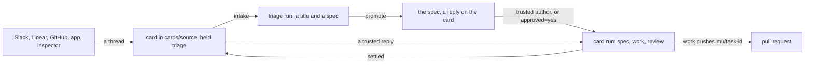

## Who this is for

You build something with agents and want to steer it from wherever you are:
a report in Slack, a Linear issue, a button in the app itself. Each report
should become a card with a proper title and spec, the change should come
back as a pull request with screenshots, and a reply on the card should send
it round again, on the same pull request, until it is right.

**You need:** what [A card queue](./19-a-card-queue.md) needs (muster where
the board is, `mu serve` behind a tunnel or a proxy, a Vercel project for the
sandboxes, a GitHub App on the repository, a model key), and the keys for
the sources you sync.

## The parts

`templates/loop` is a board module and a workflow file:



- **A card is a thread and a task.** Its hold says where it is: `triage`,
  `approval`, `working`, or `edited` when its author changed the report.
- **Each source has its own channel** under `cards/`: `cards/slack`,
  `cards/linear`, `cards/github`, `cards/app`. A card's runs are in channels
  under its own, so the card is what Slack and Linear mirror.
- **The triage agent writes the card.** It reads the report and the
  repository, changes nothing, and completes with a title on the first line,
  then what to change and how to check it. The spec goes on the card as a
  reply, written as `triage`, only when the triage run's own worker completed
  it (`workflowResult`).
- **The card run quotes that reply** with `{on.text}`, and the report with
  `{thread.text}`, both fenced as content, not instructions.

## Set it up

```bash
cp templates/loop/workflows.json ~/.config/muster/
export LOOP_TRUSTED=slack:user:U0123,gh:user:octocat
mu serve --module "$PWD/templates/loop/board.ts" --allow-host board.example.com
```

Edit `board.ts` for your Slack channel's ID, your Linear team's key and your
repository, and `workflows.json` for your repository. Put the settings in the
environment `mu serve` starts with, as for [a card queue](./19-a-card-queue.md#set-it-up),
with the secrets `board.ts` names in `env()`.

## Who may start work

`LOOP_TRUSTED` is a comma-separated list of actor IDs: a Slack user is
`<sync key>:user:<their ID>`, an app posting with a token you made is
`<your principal>+<its profile>`. You, as yourself with no profile, always
are. Read it each time a card moves, so a change takes effect at once.

- **A trusted author's report** is worked as soon as it is triaged, as long
  as it is as they first wrote it.
- **Anyone else's** waits, held `approval`, and you are told. Someone trusted
  labels it `approved=yes` (`mu label 12 approved=yes`, or in the inspector).
  A label by anyone else does nothing.
- **An author sync couldn't name** is never trusted.

## Another round

A reply on the card by someone trusted, once its run has ended, is another
round. The comment goes to the work task, the work and then its review are
sent back (`mu tasks reopen <id> --round`), and a worker takes them. The work
starts from its branch: see
[Another round on the same pull request](./06-sandboxed-agents.md#another-round-on-the-same-pull-request).
A comment made while a round runs waits for it to end. A round's reply on
the card says which comments it took.

## What you see

- **The card** in Slack, Linear or GitHub, wherever the report came from:
  the spec, the run's start and summary, the screenshots of each round, and
  the pull request's address.
- **A line from `NOTIFY_CMD`**, when it is set: a card that needs your
  approval, a task blocked on a decision, a round that is done.
- **The pull request,** one per card, with a commit per round.

## When not to

- For a report you wouldn't hand a stranger's agent: approval is per card,
  so read the spec before you approve it.
- For work that needs several pull requests: a card is one branch.
- For PR review comments as the trigger: a comment on the pull request
  doesn't start a round yet. Reply on the card.

## What goes wrong

- **A round's push is refused** with `push_conflict` when someone pushed to
  the branch while the agent worked. The task says so, and the review waits:
  read the thread, then reopen the work.
- **A run asked on an edited spec** starts nothing (`asked_message_changed`):
  a card that changed after it was triaged is triaged again.
- **The triage agent fails** a report that isn't a change to make here, with
  why, in the triage run's summary on the card. The card stays held `triage`:
  cancel it, or reply and edit the report to try again.
