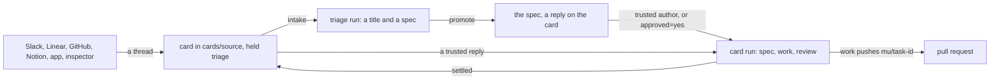

## Who this is for

You build something with agents and want to steer it from wherever you are:
a report in Slack, a Linear issue, a Notion page, a button in the app itself. Each report
should become a card with a proper title and spec, the change should come
back as a pull request with screenshots, and a reply on the card should send
it round again, on the same pull request, until it is right.

**You need:** what [A card queue](./19-a-card-queue.md) needs (muster where
the board is, `mu serve` behind a tunnel or a proxy, a Vercel project for the
sandboxes, a GitHub App on the repository, a model key), and the keys for
the sources you sync.

## The parts

`templates/loop` is a board module and a workflow file:



- **A card is a thread and a task.** Its hold says where it is: `backlog`
  while it is parked, `planning` while an agent shapes it with you, `triage`, `approval`, `working`,
  `declined` when the triage made no card, `done` when its run was approved
  but it couldn't be completed, or `edited` when its author changed the
  report.
- **Each source has its own channel** under `cards/`: `cards/slack`,
  `cards/linear`, `cards/github`, `cards/notion`, `cards/app`. A card's runs are in channels
  under its own, so the card is what Slack and Linear mirror.
- **The triage agent writes the card.** It reads the report and the
  repository, changes nothing, and completes with a title on the first line,
  then what to change and how to check it. The spec goes on the card as a
  reply, written as `triage`, only when the triage run's own worker completed
  it (`workflowResult`).
- **The card run quotes that reply** with `{on.text}`, fenced as content,
  not instructions. The triage step alone reads the report.

## Set it up

```bash
cp templates/loop/workflows.json ~/.config/muster/
export LOOP_TRUSTED=slack:user:U0123,gh:user:octocat
mu serve --module "$PWD/templates/loop/board.ts" --allow-host board.example.com
```

Edit `board.ts` for your Slack channel's ID, your Linear team's key and your
repository, and `workflows.json` for your repository. Put the settings in the
environment `mu serve` starts with, as for [a card queue](./19-a-card-queue.md#set-it-up),
with the secrets `board.ts` names in `env()`.

## Who may start work

`LOOP_TRUSTED` is a comma-separated list of actor IDs: a Slack user is
`<sync key>:user:<their ID>`, an app posting with a token you made is
`<your principal>+<its profile>`. You, as yourself with no profile, always
are. Read it each time a card moves, so a change takes effect at once.

- **A trusted author's report** is worked as soon as it is triaged, as long
  as it is as they first wrote it.
- **Anyone else's** waits, held `approval`, and you are told. Someone trusted
  labels it `approved=yes` (`mu label 12 approved=yes`, or in the inspector).
  A label by anyone else does nothing.
- **An author sync couldn't name** is never trusted, nor a GitHub author:
  GitHub's sync names one by login, which can change hands, so a GitHub
  issue always waits for an approval.
- **The work never reads the report.** The card run quotes the spec that was
  triaged (and approved, where it had to be) with `{on.text}`, never the
  report itself.

## Stages

A card starts where its source says. Only a ready card is triaged; a parked
one waits, and nothing runs for it.

| Stage | Notion Status | Linear state | Anywhere else: `stage` label | The card |
| --- | --- | --- | --- | --- |
| backlog | Not started | Backlog | `stage=backlog` | held `backlog` |
| planning | Planning | Triage | `stage=planning` | held `planning`, with a planner |
| ready | Ready | Todo | `stage=ready`, or none | triaged, then `approval` or `working` |
| working | In progress, written by the loop | In Progress, written by the loop | | held `working` |
| done | Done, written by the loop | Done, written by the loop | | completed |
| canceled | | Canceled, Duplicate | | canceled |

- **The source's status moves the card.** Move a Notion page to Ready, or a
  Linear issue to Todo, and its card is triaged. Move it back to Not started
  or Backlog and it is parked again, unless a run is going: then it stays
  `working`, and the card says so.
- **Only the source's own sync moves it.** A card's source is read from how
  the board recorded its first message, never from a label. A `state` label
  anyone else sets moves nothing, and is never read later.
- **Sources without a status** (Slack, GitHub, your app, the inspector) are
  ready when they come in. Someone trusted parks one with
  `mu label 12 stage=backlog`, and starts it with `stage=ready`. Anyone
  else's `stage` label does nothing.
- **A status the loop doesn't know** parks the card.
- **The loop writes the status back:** In progress when the work starts, and
  Done when the review completes with `approve`, which also completes the
  card. A write that fails is said on the card, as `loop`, and the card goes
  on. Notion's integration needs the "Update content" capability for it.
- **A parked card that is edited** stays parked, and is triaged from its new
  text when it is moved to ready.

The mapping is `SOURCES` in `board.ts`, by sync key. `LOOP_STAGES` replaces
an entry with JSON in the same shape:

```bash
export LOOP_STAGES='{"nt":{"type":"notion","token":"NOTION_TOKEN","stages":{"inbox":"backlog","go":"ready"},"write":{"working":"doing","done":"shipped"}}}'
```

## Planning

A card in planning gets an agent that shapes it with the people who asked,
before anything is built: the `planning` workflow, one step that reads the
report and the repository and changes nothing.

- **It answers on the card,** as `planner`: its questions, numbered, then the
  card as it stands (a title, what to change, how to check it), and how it
  would split a change too big for one pull request.
- **Each trusted reply is its next round,** on the same task: the comments go
  to it, fenced as content, and it answers again. Replies made while it
  works wait for its answer. Anyone else's replies aren't shown to it.
- **Move it to ready** (Ready, Todo, or `stage=ready`) when the card is
  right. The triage writes the spec from the newest plan and what was said
  on the card since it, and what was said in planning starts no round of the
  work.
- **Edit the report** in planning and a new planner starts from the new
  text; the old plan is not shown to the triage.
- One planner per card. Moved back to planning later, it goes on when
  someone replies.

## Related and duplicate cards

Each triage is shown the other cards, newest first, by number, hold and
first line, as many as fit in what a run quotes (2,000 characters, after the
plan when there is one). The list is a reply on the card, written as `cards` and kept on
the board: it never reaches Slack, Linear or Notion. The triage step quotes
it with `{on.text}`, as content.

- **Related:** a triage result that starts with `related: #36, #16` labels
  the card `related=36,16` and says so on the card, by number only: the card
  is mirrored where it came from, and another card's words may be private to
  its own source. When both cards are
  Linear issues of the same sync, the issues are related in Linear too.
- **The same request:** `duplicate-of: #36` holds the card `duplicate`, with
  its spec on it, and you are told. Someone trusted labels it `approved=yes`
  to work it anyway, or you cancel it. A duplicate the triage wrote no card
  for is triaged again when it is moved to ready.
- **A public source sees only public cards.** What a triage writes is
  mirrored where its card came from, so a card from a public source (GitHub
  issues; `LOOP_PUBLIC` lists the channels, comma separated) is shown only
  other public cards. A card from Slack, Linear, Notion or your app sees all.
- **Only cards of this loop count.** A number that isn't another card's (the
  card itself, a run's task, any other thread) is left out. The lines are
  taken off the spec.
- **Nothing is split.** A report that asks for several things is one card;
  the spec can list follow-ups for you to file.

## Another round

A reply on the card by someone trusted, once its run has ended, is another
round. The comment goes to the work task, the work and then its review are
sent back (`mu tasks reopen <id> --round`), and a worker takes them. The work
starts from its branch: see
[Another round on the same pull request](./06-sandboxed-agents.md#another-round-on-the-same-pull-request).
A comment made while a round runs waits for it to end. A round's reply on
the card says which comments it took; comments too long for one round wait
for the next. A card that is done comes back the
same way: a trusted reply reopens it, and its status is In progress again.

## What you see

- **The card** in Slack, Linear or GitHub, wherever the report came from:
  the spec, the run's start and summary, the screenshots of each round, and
  the pull request's address.
- **A line from `NOTIFY_CMD`**, when it is set: a card that needs your
  approval, a task blocked on a decision, a round that is done.
- **The pull request,** one per card, with a commit per round.

## When not to

- For a report you wouldn't hand a stranger's agent: approval is per card,
  so read the spec before you approve it.
- For work that needs several pull requests: a card is one branch.
- For PR review comments as the trigger: a comment on the pull request
  doesn't start a round yet. Reply on the card.

## What goes wrong

- **A round's push is refused** with `push_conflict` when someone pushed to
  the branch while the agent worked. The task says so, and the review waits:
  read the thread, then reopen the work.
- **A run asked on an edited spec** starts nothing (`asked_message_changed`):
  a card that changed after it was triaged is triaged again.
- **The triage agent fails** a report that isn't a change to make here, with
  why, in the triage run's summary on the card. The card is held `declined`,
  says so, and you are told. Edit the report, or move it to ready again, to
  try again; or cancel it. A triage whose agent stopped (out of time, a usage
  limit) is declined the same way, and its summary says so.

## Next

- [Running the feedback loop](./21-running-the-loop.md): going live,
  approving, answering a blocked task, another round, and what to do when
  something stops.
- The `loop-card` skill teaches an agent each step (triage, spec, work,
  review): `mu skills install --to ~/.claude/skills` installs it with the
  others.
