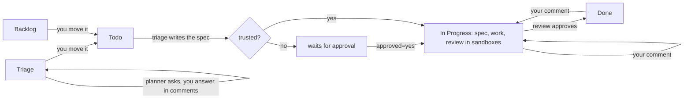

## Who this is for

You plan in Linear: a project with goals, milestones and issues. You want
agents to build it while you do something else. You want to steer them from
Linear, on your desktop or the Linear app on your phone, with GitHub holding
the change.

This guide is the Linear side of the [feedback loop](./20-a-feedback-loop.md)
template. That guide and [Running the feedback loop](./21-running-the-loop.md)
cover the machinery. This one covers how to lay out the project, the spec and
the issues so agents build the right thing, and what you do from where.

## How it fits together

Each of these lives in one place:

| What | Where | Why there |
| --- | --- | --- |
| Goals, milestones and the order of work | The Linear project | People read and reorder it there |
| The build prompt: hard rules, goals, how an agent shows its work | `AGENTS.md` and a spec file in the repository | Every agent reads the repository. A Linear document never reaches its sandbox |
| One change | One Linear issue, which is one card and one pull request | A card is one branch |
| Questions and decisions about a change | Comments on the issue | They reach the agents, and stay with the issue |
| The change itself | The pull request | Linear shows its address, the summary and screenshots as comments |
| Who may start work | `LOOP_TRUSTED` | An issue from anyone else waits for your approval |

A change goes through these steps. You move an issue into Triage, Backlog
and Todo; the loop moves it to In Progress and Done:



## What you need

Set these up first:

- A board that Linear's webhooks can reach: [A board on a server](./18-a-board-on-a-server.md).
- The loop template set up from a clone of the repository:
  [A feedback loop](./20-a-feedback-loop.md#set-it-up), then
  [Running the feedback loop](./21-running-the-loop.md#go-live).
- A Linear OAuth application with client credentials tokens turned on, so
  comments and status changes come from the app, not from you:
  [Linear sync](../02-sync/03-linear.md#who-the-comments-are-by).
- A GitHub App that can push to the repository, and a cloud runner for the
  agents: [Agents in cloud sandboxes](./06-sandboxed-agents.md).
- `AGENTS.md` and a spec in the repository, written for an agent:
  [Write the spec once, in the repository](#write-the-spec-once-in-the-repository).

## Set up Linear for agents

**Give the codebase one team.** The loop's workflows build one repository
(`repo` in `workflows.json`), and sync maps a team to a channel. In the
template's `board.ts`, map the team whose issues are about this repository,
and no other:

```ts board.ts
import { env, linear } from '@openmuster/muster'

export const sync = {
  lin: linear({
    secret: env('LINEAR_WEBHOOK_SECRET'),
    clientId: env('LINEAR_CLIENT_ID'),
    clientSecret: env('LINEAR_CLIENT_SECRET'),
    teams: { ENG: 'cards/linear' },
  }),
}
```

**Keep the statuses the loop reads.** A card follows its issue's status:

| Linear status | The card | Who sets it |
| --- | --- | --- |
| Triage | Planning: an agent asks questions and drafts | You |
| Backlog | Parked: nothing runs | You |
| Todo | Triaged into a spec, then built | You |
| In Progress | Being built | The loop, when the work starts |
| Done | The review approved the change | The loop |
| Canceled, Duplicate | Canceled | You |

Moving an issue to In Progress or Done yourself moves nothing: those are the
statuses the loop writes. A status the loop doesn't know
[parks](../01-concepts/08-tasks.md#parking-work-for-later) the card. If your
team's statuses have other names, map them with `LOOP_STAGES`
([Stages](./20-a-feedback-loop.md#stages)).

**Trust yourself.** An issue starts work without an approval only if its
author is in `LOOP_TRUSTED`. Linear users appear on the board by their user
ID, so comment on any synced issue and read the ID off the reply:

```bash
mu read cards/linear
export LOOP_TRUSTED=lin:user:3f2a9c1e-4b7d-4e0a-9a51-7c2d8e6b1f03
```

Replace the ID in the example with the one you read.

Everyone else's issues wait for an approval. A GitHub author is never
trusted.

**Show agent progress on the issue.** With `agent: true`, the issue shows the
app's agent session while a run works on it. The session shows where the run
is, and the run's last words as its response. It needs the OAuth
application's own webhook, with only Agent session events, and its signing
secret:

```ts board.ts
import { env, linear } from '@openmuster/muster'

export const sync = {
  lin: linear({
    secret: env('LINEAR_WEBHOOK_SECRET'),
    clientId: env('LINEAR_CLIENT_ID'),
    clientSecret: env('LINEAR_CLIENT_SECRET'),
    agent: true,
    appSecret: env('LINEAR_APP_WEBHOOK_SECRET'),
    teams: { ENG: 'cards/linear' },
  }),
}
```

Without `agent: true`, the issue gets the run's first progress comment as it
was first written, and the summary when the run ends.

## Write the spec once, in the repository

Every agent in the loop reads `AGENTS.md` and the project's spec before
anything else. They run in sandboxes with a clone of the repository and the
card, and nothing else: a spec kept only in a Linear document is one they
never see. Commit it, have `AGENTS.md` point to it, and link it from the
Linear project's description so people find it too.

Write it as a brief to an agent:

```markdown SPEC.md
# Inbox: build prompt

You are building Inbox, a keyboard-first desktop mail client for one user,
in React and TypeScript.

## Hard rules

- Never send real email in tests, CI, demo mode or screenshots. Tests use mocks.
- Every pull request passes `pnpm test` and `pnpm typecheck`.
- Every pull request that changes the UI includes screenshots (see 5).

## Goals

1. Instant. Everything renders from a local store. (2)
2. Calm. One centred feed, monochrome, the system font. (3)
3. Keyboard first. Every action has a shortcut and is in the ⌘K menu. (4)

## 5. Screenshots

`pnpm demo` runs the app in a browser with sample mail and no account.
Screenshot the screens your change touches, in light and dark.
```

What the example has:

- **Hard rules first:** what must never happen, and what every pull request
  must have.
- **Numbered goals:** each points to the section that details it.
- **A way for the agent to see its work:** a demo mode with sample data lets
  an agent build, test and screenshot in a sandbox with no credentials. The
  work agent takes the screenshots the spec asks for, and no others: a spec
  that asks for none gets none.

## Plan a feature with an agent

Put a new feature in **Triage**. The loop gives it a planner: an agent that
reads the issue and the repository, builds nothing, and answers on the issue
with its questions, numbered, and a draft of the change. Work with it like
this:

1. Answer in a comment. Each comment by someone trusted is the planner's next
   round, from Linear on your desktop or your phone.
2. When the change is too big for one pull request, the planner says how it
   would split it. File each part as its own issue in the project, under its
   milestone, in the order they build on each other. The planner doesn't file
   issues itself.
3. Move the issue to **Todo** when the draft is right. The triage writes the
   spec from the planner's newest draft and what was said on the issue since.

For a whole project, start with one issue in Triage that describes it
("Plan the first version of Inbox"), answer the planner, then file the split
it suggests as the project's issues.

## Write issues an agent can finish

What helps an agent finish an issue:

- **Change the issue itself until the work starts.** An edited title or
  description reaches the board, and the loop triages the issue again from
  its new text. A comment made before the work starts doesn't reach the
  triage; in Triage it goes to the planner. Once the issue is In Progress,
  say changes in a comment: that is what starts another round.
- **One issue, one pull request.** A card is one branch. Split anything
  bigger.
- **Say how to check it.** The triage writes the spec as a title, what to
  change and why, and how to check it works. The closer the issue is to that,
  the less the triage has to guess.
- **Order dependent issues yourself.** Every issue in Todo gets its own run,
  at once, each starting from the default branch. Move an issue that builds
  on another to Todo once the other's pull request is merged. Issues that
  touch different code can go together.
- **Cap the spend.** `mu budget cards 50` stops new work on cards once they
  have cost $50 in all.
- **Linear's labels and fields are for your own filters.** Labels, the
  assignee, the priority and the project arrive as labels on the card
  (`tag.bug=bug`, `priority=high`). The loop doesn't route on them.

## Let it build

Move the issue to Todo. On the issue you see, in order:

1. **The spec:** a comment written by the triage. If the triage finds
   nothing to change in this repository, it says why, and the loop
   [holds](../01-concepts/08-tasks.md#states) the card `declined`. Edit the issue to say
   more, and the loop triages it again. Or move it to Triage and work it out
   with the planner first.
2. **Approval:** for an issue whose author isn't trusted. The card waits
   until someone trusted runs `mu label <card> approved=yes`, or sets the
   label in the [inspector](./04-inspector.md). Read the spec, not only the
   issue: the spec is what the work does.
3. **In Progress:** set by the loop, with the agent session working when
   `agent: true` is set.
4. **The summary:** when the run ends, each step's result and the pull
   request's address. The work pushes `mu/task-<id>` and opens the pull
   request, titled with the card's title.
5. **The screenshots:** the round's, uploaded to Linear and linked from the
   comment. Experimental: files sent through an OAuth app haven't been
   checked against a live workspace.
6. **Done:** set by the loop when the review approves. Merging the pull
   request is yours.

## Iterate from Linear

How to steer from Linear:

- **Comment on the issue for another round on the same pull request.** The
  comment goes to the agent, the work and its review run again, and the
  commit is pushed to the same branch. A comment made while a round runs
  waits for it to end. A comment on an issue that is Done reopens it, and the
  loop sets In Progress again.
- **Comment on the issue, not on the pull request.** A comment on the pull
  request doesn't start a round.
- **Keep the decision on the issue.** "The accent should be this colour" is a
  comment on the issue. How the agent got there belongs in the pull request.

## What you still do on the board

Where each job is done:

| To do this | Do it here |
| --- | --- |
| Start, park, plan or cancel a change | Linear: the issue's status |
| Answer the planner, or ask for another round | Linear: a comment on the issue |
| Approve someone else's issue | The board: `mu label <card> approved=yes`, or the inspector |
| Answer an agent that blocked on a decision | The board: `mu reply <task> "…"`, then `mu tasks unblock <task>` |
| See what waits on you | The board: `mu tasks cards/ --state blocked`, or `NOTIFY_CMD` |

An agent that blocks mid-run blocks its own task, which isn't the card, so
its question doesn't reach Linear. Set `NOTIFY_CMD` so you hear about it:
[What you hear about](./21-running-the-loop.md#what-you-hear-about).

## Feedback from the app you are building

Small bugs reported from the app don't need planning. Give the app a token
that can only post reports, and send them from the app's server:

```bash
mu token create --as my-app --can 'cards/app=post' --ttl 90d
```

A report from the app is ready when it arrives: the triage turns it into a
card, which waits for your approval unless the app's reports are trusted
([Your app's feedback button](https://github.com/openmuster/muster/tree/main/templates/loop#your-apps-feedback-button)).
Use Triage in Linear for what you want to talk through first, and Todo for
what you already know.

## Coming back later

Everything about a change is on its issue: the spec, each round's summary
and screenshots, and the pull request. The project's issue list says what is
done, what is in progress and what is next. On the board,
`mu tasks cards/ --state blocked` lists what waits on you.

## When not to use the loop

The loop is the wrong tool in these cases:

- **It doesn't fit work you can't split into pull-request-sized issues.** A
  card is one branch.
- **It doesn't work with the spec only in Linear.** Agents read the
  repository.
- **It doesn't fit issues from people you wouldn't hand an agent.** Approval
  is per card: read each spec before you approve it.
- **A single label-triggered pass with no rounds needs less.**
  [A card queue](./19-a-card-queue.md) is smaller: label an issue `agent` and
  get a spec, a pull request and a review back once.

## What goes wrong

Symptoms, causes and fixes:

- **Nothing happens when an issue moves to Todo.** The webhook isn't reaching
  the board (Linear's webhook settings list each delivery; `mu daemon status`
  names the sync), the issue is in a team that isn't mapped, or its status
  has a name the loop doesn't know, which parks it.
- **A round ignores what you wrote in the description.** The issue was
  edited after its work started. Say the change in a comment, which starts a
  round.
- **A card waits for approval on your own issue.** Your Linear user ID isn't
  in `LOOP_TRUSTED`.
- **The status doesn't change.** The loop writes it as the OAuth app, with
  its sync's scopes. Linear revokes an app's earlier tokens when one is asked
  for with other scopes, so a sync given its own `scopes` needs the same in
  its `SOURCES` entry ([Stages](./20-a-feedback-loop.md#stages)).
- **Two pull requests conflict.** Two issues in Todo changed the same code.
  Merge one, resolve the other's branch, then comment on its issue if it
  needs another round: the round starts from the branch as you left it.

## Related guides

Where to go next:

- [A feedback loop](./20-a-feedback-loop.md): every stage, planning, related
  and duplicate cards.
- [Running the feedback loop](./21-running-the-loop.md): going live,
  approving, answering, and what to do when something stops.
- [Linear sync](../02-sync/03-linear.md): what comes in, what goes back, and
  the OAuth app.
